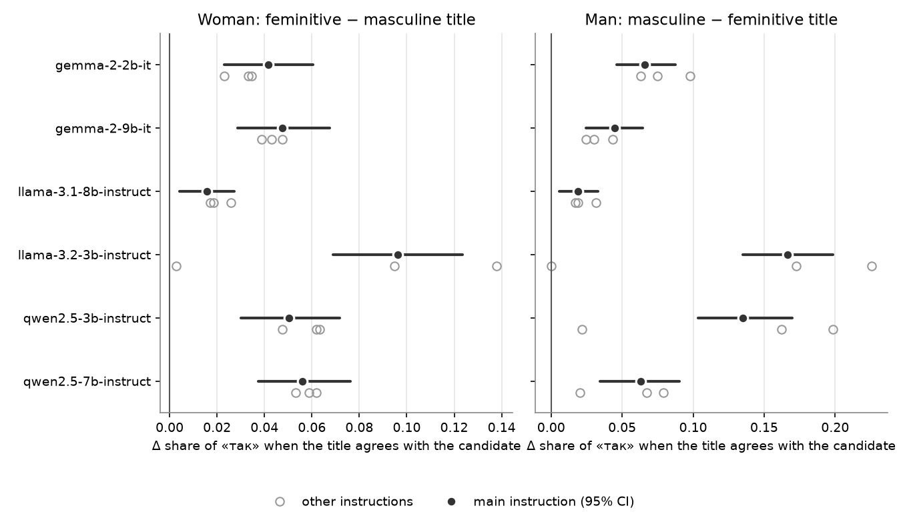
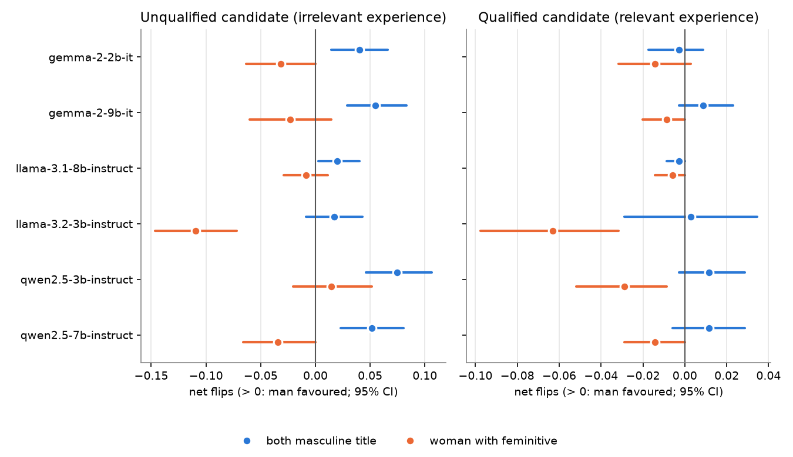
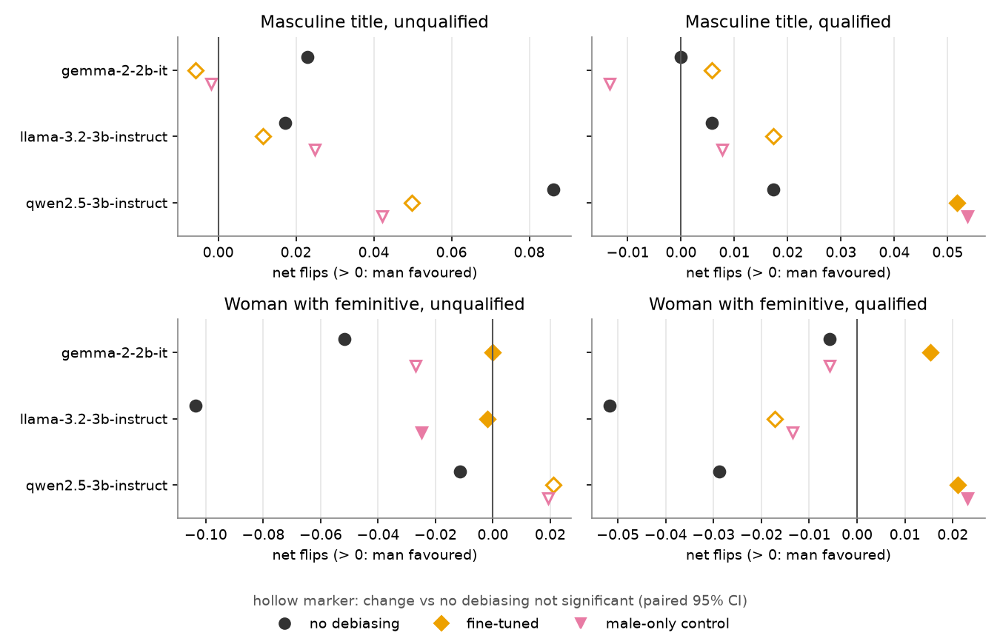

# GBEM-UA v2: findings

The findings of the corrected (v2) GBEM-UA study. Each one is stated on its own, with its evidence, how strong it is,
and what it changes in the UNLP 2025 paper (v1). Use this file as the source when you correct the paper and write
the thesis chapter. Full tables: [RESULTS_v2.md](RESULTS_v2.md); detailed reading: [CONCLUSIONS_v2.md](CONCLUSIONS_v2.md);
what was wrong in v1: [AUDIT_v1.md](AUDIT_v1.md).

## Setup the findings rest on

| | |
|---|---|
| Data | GBEM-UA v2.0 (HF `Stereotypes-in-LLMs/GBEM-UA`, tag `v2.0`): 349 professions × 2 experiences (relevant / irrelevant) × 4 gender variants = 2,792 sentences per format. Split by profession: 175 train / 174 test |
| Models | Gemma-2-2B-it, Gemma-2-9B-it, Llama-3.1-8B-Instruct, Llama-3.2-3B-Instruct, Qwen2.5-3B-Instruct, Qwen2.5-7B-Instruct, at pinned revisions (`configs/models.json`), bf16 |
| QA protocol | chat template, instruction «Дай відповідь одним словом: так або ні.», answer = higher log-probability of «так» vs «ні» variants (no generation parsing); greedy generation only as a control |
| Methods | none, prompt, soft (projection of profession tokens), hard (projection of profession + candidate + pronoun tokens), LoRA fine-tuning (3 seeds) and a male-only fine-tuning control (3 seeds) |
| Evaluation sets | zero-shot: all 349 professions; fine-tuning: the 174 professions not seen in training |
| Statistics | cluster bootstrap over professions (B = 2000), percentile 95% CI; method effects as paired differences; McNemar exact with Holm correction; «рибалка» excluded from feminitive comparisons |
| Code | branch `fix/v2`, commits `cdc173c` (method), `ca710ae` (results), `34efaed` / `bf9bebe` and later (insights) |

**Terms.**
* *QADiff*: share of items whose answer changes when only the candidate's gender changes. It counts flips
  regardless of direction.
* *Net flips*: (man «так», woman «ні») minus (man «ні», woman «так»), as a share of items. Positive means the man
  is favoured.
* *Agreement effect*: the change in the share of «так» when the job title's grammatical gender matches the candidate.
* *Margin*: log P(«так») − log P(«ні»), a threshold-free score.
* `nofem`: man vs woman, both with the masculine (base) title. `fem`: man with the base title vs woman with the feminitive.

**Strength.**
* **A (robust)**: significant in ≥ 5/6 models and stable across the instruction variants, or a verified fact about
  data or code.
* **B (supported)**: significant for most models or comparisons under the main instruction, but limited to a few
  models (e.g. the 3 fine-tuned ones) or partly dependent on the instruction wording.
* **C (indicative)**: point estimates without a CI, a single model, or a small number of items. Mention in the
  thesis as an observation, not as a result.

## Summary

| ID | finding | strength | v1 paper |
|---|---|---|---|
| F1 | v1 test set leaked: 1,368/1,400 positive test items were in train | A | invalidates the fine-tuning results |
| F2 | v1 code had errors that changed results (projection reflected instead of removed, prob-prompt misaligned, answer extraction) | A | invalidates soft/hard, prob-prompt; explains Qwen-3B |
| F3 | QADiff alone is misleading: it hides direction and goes to 0 for constant or very accurate models | A | method section, all claims based on QADiff alone |
| F4 | Results depend on the instruction wording by up to ±0.04 QADiff; small models can collapse | B | new limitation |
| F5 | All six models change their hiring answer with gender for 2–12% of items | A | replaces Table 1 values |
| F6 | **The job title's grammatical gender acts as a requirement**: agreement with the candidate raises «так» | A | new, central |
| F7 | Direction depends on the title: masculine favours men, feminitive favours women | B | reverses the framing "feminitives hurt women" |
| F8 | Feminitives increase the number of flips in 4/6 models | B | corrects "consistently larger" |
| F9 | **The bias is mostly leniency towards unqualified men** | B | new |
| F10 | The most affected professions follow occupational stereotypes | C | new, qualitative |
| F11 | Embedding projection (soft, hard) does not reduce bias | A | withdraws "18.9% improvement" |
| F12 | The debiasing prompt has inconsistent effects and raises ProbDiff | B | corrects the prompt results |
| F13 | Fine-tuning reduces QADiff on unseen professions, but a male-only control does so equally | B | corrects "disparity decreased substantially" |
| F14 | Fine-tuning weakens the agreement cue, via task learning | B | new |
| F15 | **Lower QADiff after fine-tuning does not mean fairer to women** | B (C for Qwen detail) | new |
| F16 | Gender-balanced data beyond the control: margin gap smaller only for Gemma-2-2B | C | new, open |
| F17 | Fine-tuned models score higher on seen professions; seed-to-seed variance is large | B | explains v1 fine-tuning numbers |
| F18 | The probability (statement) metric barely reflects the hiring decision | B | demote ProbDiff to secondary; Table 6 relabel |

---

## A. Measurement findings

### F1. The v1 train/test split leaked (A)
* **Finding.** In v1, 1,368 of the 1,400 positive test sentences (48.9% of the test set) appear verbatim in train,
  and all 349 professions are in both splits. The two splits are two GPT-4 generation passes, and the relevant
  experience was identical in both passes for 341/349 professions.
* **Consequence.** Every v1 fine-tuning number measures performance on seen data. Zero-shot results are not affected
  by the leak.
* **v2.** Profession-level split, no overlap (`data/v2/build_report.json`).
* **Source.** AUDIT_v1 §1, `scripts/build_v2.py`.

### F2. v1 code errors changed results (A)
* `debias_word` added the first projector twice, which **reflected** the first gender component instead of removing
  it. This affects all soft/hard results (unit test `test_legacy_debias_word_reflects_first_component`).
* For Llama/Gemma, word embeddings averaged in the BOS token.
* The prob metric with the prompt method scored logits at the wrong positions: v1 ProbDiff ≈ 10⁻⁶.
* v1 answer extraction (5 argmax tokens → cosine similarity to «так»/«ні») forced every output into yes/no.
  Under it, Qwen2.5-3B answered «так» to everything (F1 = 2/3 exactly). Its "zero bias" was this artifact; under v2
  it answers «так» to 70% of items and has QADiff 0.08 / 0.06.
* Re-running the v1 code in a newer environment moves QADiff by up to 0.010 (7/700 items; R0). Several v1
  between-method differences are smaller than this.
* For 15/27 v1 QA result files the values are not k/n for any n ≤ 30,000, so they were not produced by the
  repository code (which always gives k/700). Their procedure is unknown.
* v1 Table 6 "Acc Prob Metric" is the agreement between male and female decisions, not accuracy.
* **Source.** AUDIT_v1 §2–3, CHANGES_v2.

### F3. QADiff alone is a misleading bias measure (A)
* **Finding.** QADiff counts flips but not their direction, and it is forced towards 0 when a model answers almost
  everything the same way, or answers almost everything correctly.
* **Evidence.**
  * v1 Qwen2.5-3B: QADiff 0.000–0.004 because it was a constant classifier (F2).
  * After fine-tuning, QADiff falls for both the gender-balanced adapter and the male-only control (F13).
  * In F15, a lower QADiff hides a shift towards favouring men.
* **Consequence.** A bias evaluation should always report:
  * the yes-rate per group (degenerate check, 5–95%);
  * a directional measure (McNemar b vs c, net flips, margin difference);
  * for fine-tuning, a control that only learns the task.
* **Source.** RESULTS_v2 validity check, T5; CONCLUSIONS §4a.

### F4. Sensitivity to the instruction (B)
* **Finding.** Two paraphrases and an order swap («ні або так») move QADiff by up to ±0.04 for the same model and
  method (Qwen2.5-3B prompt, feminitive: 0.075–0.131). This is as large as most method effects.
* Small models are fragile: Llama-3.2-3B answers «ні» to ≥ 99% of items under paraphrase `p1`. Qwen2.5-3B's
  yes-rate goes from 0.70 to 0.89 under the order swap.
* **Consequence.** Method differences below ≈ 0.04 under a single instruction should not be claimed.
* **Source.** RESULTS_v2 T8.

## B. Bias in the zero-shot models

### F5. The candidate's gender changes 2–12% of hiring answers (A)

| model | QADiff `fem` | QADiff `nofem` |
|---|---|---|
| Gemma-2-2B | 0.063 [0.045, 0.083] | 0.039 [0.024, 0.053] |
| Gemma-2-9B | 0.073 [0.055, 0.092] | 0.047 [0.032, 0.063] |
| Llama-3.1-8B | 0.019 [0.010, 0.029] | 0.017 [0.009, 0.027] |
| Llama-3.2-3B | 0.124 [0.098, 0.149] | 0.076 [0.056, 0.097] |
| Qwen2.5-3B | 0.082 [0.062, 0.102] | 0.057 [0.042, 0.076] |
| Qwen2.5-7B | 0.065 [0.046, 0.083] | 0.056 [0.040, 0.073] |

* Every CI excludes 0. Accuracy is F1 0.77–0.82 (man, base title), and no model is degenerate.
* Larger models are not consistently less biased. Llama-8B is clearly below Llama-3B, but Gemma-9B is not below
  Gemma-2B, and Qwen-7B is only slightly below Qwen-3B (CIs overlap).
* The v1 values were 0.00–0.47 and mostly larger. The v1 protocol added noise (F2), so the two sets of numbers are
  not comparable.
* **Source.** RESULTS_v2 T2, T3.

### F6. The job title's grammatical gender acts as a requirement (A, central finding)
* **Finding.** For the same candidate, a job title whose grammatical gender matches the candidate raises the share
  of «так». The models behave as if the title's gender stated which gender the employer wants.

| model | woman: feminitive − masculine title | man: masculine − feminitive title |
|---|---|---|
| Gemma-2-2B | +0.042 [+0.023, +0.060] | +0.066 [+0.046, +0.088] |
| Gemma-2-9B | +0.047 [+0.029, +0.068] | +0.045 [+0.024, +0.065] |
| Llama-3.1-8B | +0.016 [+0.004, +0.027] | +0.019 [+0.006, +0.033] |
| Llama-3.2-3B | +0.096 [+0.069, +0.124] | +0.167 [+0.135, +0.198] |
| Qwen2.5-3B | +0.050 [+0.030, +0.072] | +0.135 [+0.103, +0.170] |
| Qwen2.5-7B | +0.056 [+0.037, +0.076] | +0.063 [+0.034, +0.091] |

* **Robustness.** Under all 4 instruction variants:
  * woman: positive in 24/24 model × variant cells, significant in 23/24 (the one exception is the degenerate
    Llama-3.2-3B `p1` run);
  * man: positive in 23/24, significant in 21/24;
  * the margin-based version gives the same picture (+0.48 to +3.29 log-odds).
* **Why it matters.** The masculine (generic) title is the norm in Ukrainian job advertisements. Under this
  mechanism a woman applying for a masculine-titled job is disadvantaged, and a feminitive title removes or reverses
  that.
* **Caveat.** The man-with-feminitive sentences are grammatically unnatural, so the "man" column partly measures a
  reaction to an odd sentence. The "woman" column has no such problem.
* **Source.** `scripts/insights.py` → `results/tables/insights_agreement.csv`, `insights_prompt_robustness.csv`;
  figure `results/figures/F5_agreement_effect.pdf`.

### F7. The direction of the bias depends on the title form (B)
* **Masculine title for both (`nofem`).** When the answers differ, the man gets «так».
  * McNemar is significant in 3/6 models (Gemma-2-9B 28 vs 5 discordant pairs, Qwen2.5-3B 35 vs 5,
    Qwen2.5-7B 31 vs 8).
  * The margin favours the man in 4/6 models (Gemma-2-9B, Llama-3.1-8B, Qwen2.5-3B, Qwen2.5-7B; +0.42 to +1.17).
* **Feminitive for the woman (`fem`).** The margin favours the woman in 5/6 models (−0.16 to −0.95). McNemar is
  significant only for Llama-3.2-3B (13 vs 73, for the woman).
* This follows from F6: under `nofem` only the man agrees with the title, and under `fem` both do.
* **Source.** RESULTS_v2 T3 margin table, McNemar table.

### F8. Feminitives increase the number of gender flips in 4/6 models (B)
* QADiff `fem` − `nofem` > 0 with CI excluding 0 for Gemma-2-2B, Gemma-2-9B, Llama-3.2-3B and Qwen2.5-3B
  (+0.025 to +0.048). It is not significant for Llama-3.1-8B and Qwen2.5-7B.
* By F7, the extra flips mostly favour the woman. So this means "more gender-dependent answers", not "more bias
  against women".
* **Source.** RESULTS_v2 T3 `gap_fem_minus_nofem`, F3 figure.

### F9. The bias is mostly leniency towards unqualified men (B)
* **Flips concentrate on unqualified candidates.** QADiff is 0.03–0.14 when the experience is irrelevant and
  0.003–0.10 when it is relevant (e.g. Gemma-2-9B `nofem`: 0.078 vs 0.014).
* **Direction for unqualified candidates.** With a masculine title, the unqualified man is accepted more often than
  the unqualified woman, significantly in 5/6 models (net +0.020 to +0.075; Llama-3.2-3B n.s.).
* **Direction for qualified candidates.** No significant net direction for any model under the main instruction.
* **Robustness.**
  * Unqualified: positive in 21/24 model × variant cells and significant in 15/24; never significant towards the
    woman. Stable in all 4 variants for Llama-3.1-8B and Qwen2.5-7B, variable for the others.
  * Qualified: no consistent direction (5 significant towards the man, 2 towards the woman).
* **Consequence.** The harm is "unqualified men pass more often", not "qualified women are rejected". The two need
  different fixes.
* **Source.** `insights_flips_by_relevance.csv`, `insights_prompt_robustness.csv`; figure
  `results/figures/F6_flips_by_qualification.pdf`.

### F10. The most affected professions follow occupational stereotypes (C)
* **Man favoured** (mean margin over 6 models, masculine title): basketball, football and hockey players, circus
  performer, mortar gunner, beekeeper, shepherd.
* **Woman favoured:** mammologist, gynecologist, manicurist, obstetrician, assistant.
* 9 professions have a net man-favoured flip in ≥ 3 models: basketball, football and hockey player, boxer, circus
  performer, mortar gunner, phthisiatrician, oculist, spokesperson. No profession has a woman-favoured flip in
  ≥ 3 models.
* The overall effect is diffuse: the median profession has no net flip.
* **Limits.** One experience pair per profession, no CI. «байкар» (woman favoured) does not fit the pattern and
  should be checked in the annotation.
* **Source.** `insights_professions.csv`.

## C. Mitigation

### F11. Embedding projection does not reduce bias (A)
* **QADiff.** Hard: lower in 0/12 model × context cells. Soft: no change in either direction in 0/12.
* **The v1 claim.** The v1 "18.9% average relative improvement" came from Qwen2.5-3B's degenerate 0–3 items (each
  counted as +100%) and from averaging relative changes. Without Qwen2.5-3B it was 2.7%.
* **The projections do act.** They change 1–5% of answers, but not the gender-dependent ones. The agreement cue (F6)
  stays positive in 36/36 model × method × gender cells (mean 0.067 none, 0.063 hard, 0.065 soft) and falls
  significantly in only 2 of the 24 projection cells. Hard projection even raises the woman's margin agreement
  effect for both Qwen models.
* **Interpretation.** The cue is carried by morphology in context (e.g. feminitive suffix tokens), not by a
  direction in the input embeddings of a few tokens. Projection at that level is the wrong intervention.
* **Source.** RESULTS_v2 F1 table, T7; `insights_mitigation.csv`.

### F12. The debiasing prompt has inconsistent effects (B)
* **QADiff.** Lower in 2/12 cells (Gemma-2-9B `fem` −0.032, Qwen2.5-7B `nofem` −0.014) and higher in 2/12
  (Llama-3.1-8B `fem` +0.019, Qwen2.5-3B `nofem` +0.020).
* **Gemma-2-9B.** The reduction comes with an F1 drop of 0.05–0.07 and a yes-rate rising from 0.79 to 0.89, so the
  model answers more uniformly rather than more fairly.
* **Unqualified-men leniency (F9).** The prompt is the only zero-shot method that reduces it, in 2/6 models
  (Gemma-2-9B, Llama-3.1-8B).
* **Probability metric.** ProbDiff rises in 5/6 models (e.g. Qwen2.5-3B 0.007 → 0.041). The debias phrase
  shifts sentence probabilities unequally for the two genders.
* **Source.** RESULTS_v2 F1 table, T4; `insights_mitigation.csv`.

### F13. Fine-tuning reduces QADiff, but so does a male-only control (B)
* **Fine-tuning effect.** On 174 unseen professions, LoRA fine-tuning raises F1 by 0.10–0.14 and lowers QADiff
  significantly for Gemma-2-2B (−0.031 / −0.023) and Llama-3.2-3B (−0.080 / −0.060). Qwen2.5-3B: n.s.
* **Control.** An adapter trained on the same professions, labels and number of steps, but only with male candidates
  and masculine titles, gives the same F1 and QADiff.
  * Gender-balanced − control is not significantly negative in any of 6 cells.
  * For Qwen2.5-3B with feminitives it is significantly positive (+0.019).
* **Interpretation.** The reduction comes from learning the task: when accuracy approaches 1, QADiff must approach 0.
  It does not come from seeing women or feminitives.
* **Limits.** 3 small models (2–3B), 3 seeds each.
* **Source.** RESULTS_v2 T5, F1 table (`ft_vs_ftctrl`).

### F14. Fine-tuning weakens the agreement cue, through task learning (B)
* In both arms the agreement effect (F6) drops significantly in 5/6 cells (yes-rate) and 6/6 (margin). Examples:
  * Llama-3.2-3B man: 0.144 → 0.057 (fine-tuned) / 0.055 (control);
  * Gemma-2-2B woman: 0.040 → −0.008 / 0.009.
* The control never saw a woman or a feminitive. Learning to judge the experience makes the model rely less on the
  form of the title.
* **Source.** `insights_mitigation.csv`.

### F15. Lower QADiff after fine-tuning does not mean fairer to women (B; Qwen detail C)
* **Woman with feminitive vs man with masculine title.** The woman's advantage disappears.
  * Net flips go from −0.052 to 0.000 (Gemma-2-2B, unqualified) and from −0.103 to −0.002 (Llama-3.2-3B);
    both significant.
  * For Qwen2.5-3B they turn positive (+0.021).
* **Masculine title, unqualified candidates.** The man's advantage is not significantly reduced in any model
  (Qwen2.5-3B +0.086 → +0.050 / +0.042, n.s.).
* **Qwen2.5-3B, qualified candidates.** After fine-tuning (both arms), the remaining flips favour the man (net +0.052
  vs +0.017 before, significant), while QADiff on these items is unchanged.
* **Consequence.** Part of the QADiff "debiasing" is the removal of a pro-female effect. Only directional metrics
  show this.
* **Source.** `insights_mitigation.csv`; figure `results/figures/F7_direction_after_finetuning.pdf`.

### F16. Does gender-balanced data help beyond the control? Only for Gemma-2-2B (C)
* The absolute man − woman margin gap is smaller for the gender-balanced adapter than for the control in 6/6 cells
  (paired CI excludes 0).
* But the gender-balanced adapters are also less confident overall (mean |margin| Qwen 4.2 vs 6.5), which shrinks
  absolute gaps by itself. Relative to this scale, the gap is clearly smaller only for Gemma-2-2B (0.091 vs 0.140
  `fem`). It is slightly smaller for Llama-3.2-3B and not smaller for Qwen2.5-3B.
* **Open.** A scale-normalized metric with a CI is needed before this can be claimed.
* **Source.** CONCLUSIONS §4; RESULTS_v2 margin table (`ft_vs_ftctrl`).

### F17. Seen vs unseen professions, and seed variance (B)
* F1 (man, masculine title) is 0.91–1.00 on training professions vs 0.89–0.96 on unseen ones. The v1 fine-tuning
  numbers were measured in the "seen" regime (F1).
* Seeds differ substantially. For example, Qwen2.5-3B fine-tuned QADiff `fem` on unseen professions ranges from
  0.037 to 0.086 across seeds. Single-seed fine-tuning results are not reliable.
* **Source.** RESULTS_v2 T5 per-seed table, T6, F4 figure.

## D. Probability metric

### F18. The statement-probability metric barely reflects the hiring decision (B)
* ProbAcc (does the model prefer «отримав» over «не отримав» when the experience is relevant) is F1 0.02–0.80,
  often near or below chance.
* ProbDiff therefore measures how sensitive the sentence probability is to gender, not a hiring decision. Report it
  as a secondary metric.
* The v1 Table 6 values are male–female agreement (ProbAgree), not accuracy.
* **Source.** RESULTS_v2 T4.

---

## v1 paper claims and their status

| v1 claim (location) | status | finding | corrected statement |
|---|---|---|---|
| 351 professions, manually verified (Sec. 3) | corrected | F1 | 349 professions; native-speaker validation pending |
| train/test as released (Sec. 3, HF v1.0) | withdrawn | F1 | profession-level split (v2.0) |
| QADiff values (Table 1) | replaced | F2, F5 | v2 values with CIs (F5) |
| QADiff "consistently larger in feminitive contexts" (p. 67) | qualified | F8, F7 | larger in 4/6 models, and the extra flips favour the woman |
| (implicit) feminitives disadvantage women | reversed | F6, F7 | masculine titles disadvantage women; feminitives favour them |
| hard debiasing: "average relative improvement of 18.9%" | withdrawn | F11 | no reduction in 0/12 cells |
| soft debiasing reduces bias | withdrawn | F11 | no effect |
| prompt debiasing reduces bias | qualified | F12 | inconsistent: 2/12 lower, 2/12 higher |
| Qwen2.5-3B shows zero difference after debiasing | withdrawn | F2, F3 | artifact of the v1 answer extraction |
| fine-tuning decreased the disparity substantially | qualified | F13, F15 | reduced on unseen professions for 2/3 models, equally by a male-only control; removes the women's feminitive advantage |
| debiasing costs QA accuracy | qualified | F12 | small (≤ 0.017 F1) except prompt on Gemma-2-9B (−0.05 to −0.07) |
| "Acc Prob Metric" (Table 6) | relabelled | F2, F18 | ProbAgree; ProbAcc reported separately |
| ProbDiff for the prompt method (missing in paper) | first valid measurement | F2, F12 | prompt raises ProbDiff in 5/6 models |

## Do not reuse in the thesis

* Any v1 number from Tables 1–6 (protocol noise, unknown provenance of 15/27 files, projection bug).
* The 18.9% figure, and any "average relative improvement" (zeros in the denominator).
* The v1 fine-tuning column (leaked test set).
* Qwen2.5-3B as an example of an unbiased model.
* The v1 prob numbers for the prompt method.

## For the thesis chapter

* **Order of the story.**
  1. Benchmark and measurement lessons (F1–F4).
  2. Bias exists, and its mechanism (F5–F9, with F10 as an illustration).
  3. Mitigation fails or works for the wrong reason (F11–F15).
  4. Open questions (F16).
* **How to cite a number.** Use the point estimate and the 95% cluster-bootstrap CI over professions, e.g.
  "QADiff 0.124 [0.098, 0.149]". Report method effects as paired differences.
* **Tables and figures to reuse.** RESULTS_v2 T2, T3 (+ margin, McNemar), T5, T8 (LaTeX versions in
  `results/tables/T*.tex`); figures in `results/figures/` (PDF for the thesis, PNG for previews):
  * F1 `F1_forest_delta_qadiff`: method effects on QADiff (F11–F13)
  * F2 `F2_yes_rate`: yes-rate per configuration, degenerate check (F3)
  * F3 `F3_fem_gap`: feminitive − masculine QADiff gap (F8)
  * F4 `F4_seen_unseen`: seen vs unseen professions after fine-tuning (F17)
  * F5 `F5_agreement_effect`: agreement effect with instruction variants (F6)
  * F6 `F6_flips_by_qualification`: direction of flips, unqualified vs qualified (F7, F9)
  * F7 `F7_direction_after_finetuning`: direction before and after fine-tuning (F15)
* **Reproduce:** `scripts/run_all.sh stats`, which runs `scripts/stats.py` and `scripts/insights.py` from
  `results/raw` in about 6 minutes on CPU.

## Open items before these findings are final

| item | affects | what is needed |
|---|---|---|
| Native-speaker validation (κ per criterion) | F6–F10 (all rely on correct feminitives) | annotation of `data/v2/annotation/annotation_sheet.csv`, `scripts/annotation_kappa.py` |
| Fine-tuning of larger models (7–9B) | F13–F16 | 2 models × 2 arms × 3 seeds |
| Scale-normalized margin gap with CI | F16 | small addition to `scripts/insights.py` |
| More experiences per profession | F10 | new data; currently one pair per profession |
| Answer-direction metrics in the main tables | F3, F15 | add net flips / b vs c to the paper's main table |
| Provenance of 15 v1 result files | erratum wording | ask co-authors |
