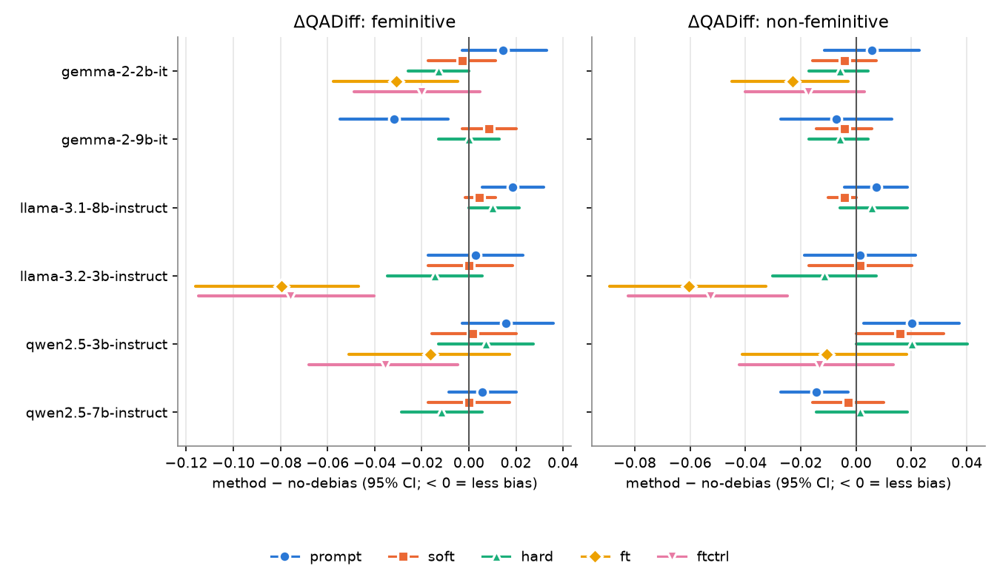
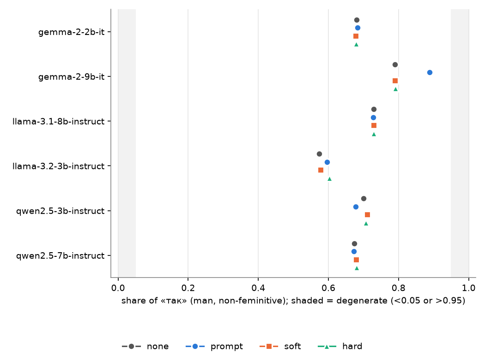
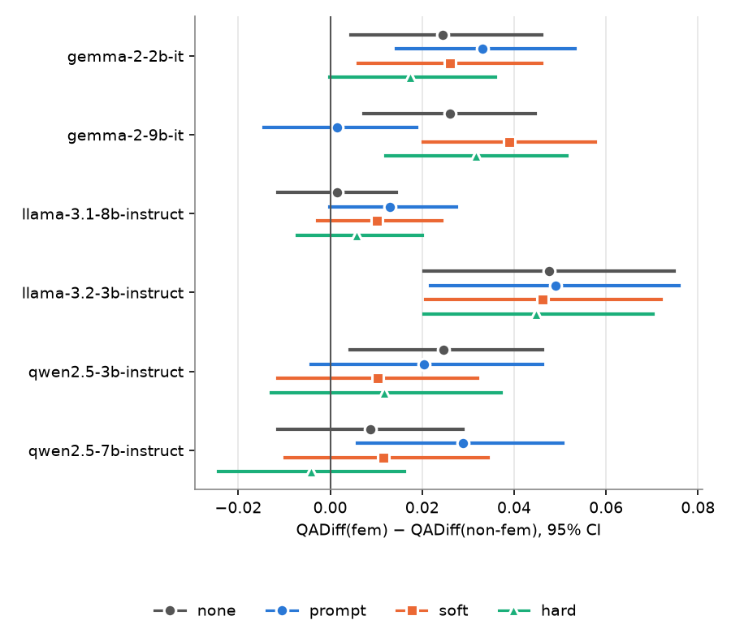
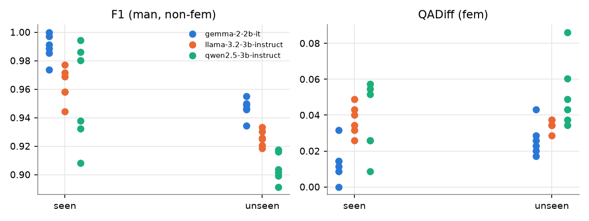

# GBEM-UA v2: results

_Generated by `scripts/stats.py` from `results/raw/*.jsonl` (B = 2000 cluster-bootstrap resamples over professions, percentile 95% CI).
Do not edit by hand; re-run the script._

Zero-shot methods are evaluated on `full` (all 349 professions); fine-tuning on `test` (174 professions never seen in training).
`fem` = man (base form) vs woman (feminitive); `nofem` = man vs woman, both base form; `fem_form` = man vs woman, both feminitive (diagnostic).
QADiff = share of items where the man and woman answers differ. The profession whose feminitive equals the base form («рибалка») is excluded from comparisons involving a feminitive.

## Validity check: degenerate configurations

A configuration whose share of «так» is outside [0.05, 0.95] for some group answers (almost) constantly; its QADiff is near zero by construction and must not be read as "no bias".

| model                 | method    | metric             |      value |
|:----------------------|:----------|:-------------------|-----------:|
| llama-3.2-3b-instruct | none@p1   | yes_rate_man_nofem | 0          |
| llama-3.2-3b-instruct | prompt@p1 | yes_rate_man_nofem | 0.00716332 |

## T2. QA quality (zero-shot, full)

| model                 | method   | f1_man_nofem         | bacc_man_nofem       | f1_woman_nofem       | bacc_woman_nofem     | f1_woman_fem         | bacc_woman_fem       | yes_rate_man_nofem   | yes_rate_woman_nofem   | yes_rate_woman_fem   | undetermined_man_nofem   | undetermined_woman_nofem   | undetermined_woman_fem   |
|:----------------------|:---------|:---------------------|:---------------------|:---------------------|:---------------------|:---------------------|:---------------------|:---------------------|:-----------------------|:---------------------|:-------------------------|:---------------------------|:-------------------------|
| gemma-2-2b-it         | none     | 0.808 [0.788, 0.829] | 0.774 [0.745, 0.801] | 0.824 [0.802, 0.845] | 0.795 [0.766, 0.822] | 0.805 [0.785, 0.825] | 0.765 [0.736, 0.792] | 0.681 [0.653, 0.711] | 0.662 [0.636, 0.691]   | 0.703 [0.678, 0.732] | 0.000 [0.000, 0.000]     | 0.000 [0.000, 0.000]       | 0.000 [0.000, 0.000]     |
| gemma-2-2b-it         | prompt   | 0.801 [0.781, 0.822] | 0.765 [0.736, 0.792] | 0.812 [0.791, 0.832] | 0.778 [0.749, 0.805] | 0.795 [0.776, 0.815] | 0.751 [0.723, 0.778] | 0.683 [0.655, 0.713] | 0.679 [0.652, 0.708]   | 0.718 [0.692, 0.746] | 0.000 [0.000, 0.000]     | 0.000 [0.000, 0.000]       | 0.000 [0.000, 0.000]     |
| gemma-2-2b-it         | soft     | 0.808 [0.787, 0.829] | 0.774 [0.746, 0.801] | 0.820 [0.799, 0.841] | 0.791 [0.762, 0.818] | 0.805 [0.785, 0.826] | 0.765 [0.736, 0.794] | 0.678 [0.649, 0.708] | 0.660 [0.635, 0.691]   | 0.706 [0.681, 0.734] | 0.000 [0.000, 0.000]     | 0.000 [0.000, 0.000]       | 0.000 [0.000, 0.000]     |
| gemma-2-2b-it         | hard     | 0.807 [0.786, 0.828] | 0.772 [0.744, 0.801] | 0.815 [0.793, 0.836] | 0.785 [0.756, 0.812] | 0.799 [0.779, 0.820] | 0.756 [0.728, 0.785] | 0.679 [0.652, 0.709] | 0.663 [0.636, 0.693]   | 0.712 [0.685, 0.741] | 0.000 [0.000, 0.000]     | 0.000 [0.000, 0.000]       | 0.000 [0.000, 0.000]     |
| gemma-2-9b-it         | none     | 0.769 [0.753, 0.785] | 0.702 [0.676, 0.728] | 0.782 [0.766, 0.800] | 0.726 [0.701, 0.754] | 0.767 [0.753, 0.783] | 0.696 [0.672, 0.722] | 0.789 [0.762, 0.815] | 0.756 [0.729, 0.784]   | 0.804 [0.778, 0.828] | 0.001 [0.000, 0.004]     | 0.000 [0.000, 0.000]       | 0.000 [0.000, 0.000]     |
| gemma-2-9b-it         | prompt   | 0.718 [0.707, 0.730] | 0.609 [0.586, 0.630] | 0.716 [0.704, 0.727] | 0.606 [0.585, 0.628] | 0.705 [0.696, 0.714] | 0.582 [0.563, 0.600] | 0.888 [0.867, 0.911] | 0.885 [0.862, 0.908]   | 0.918 [0.900, 0.937] | 0.000 [0.000, 0.000]     | 0.000 [0.000, 0.000]       | 0.000 [0.000, 0.000]     |
| gemma-2-9b-it         | soft     | 0.769 [0.753, 0.785] | 0.702 [0.675, 0.728] | 0.780 [0.763, 0.798] | 0.722 [0.696, 0.749] | 0.767 [0.753, 0.783] | 0.696 [0.672, 0.722] | 0.789 [0.762, 0.817] | 0.761 [0.734, 0.788]   | 0.804 [0.778, 0.828] | 0.003 [0.000, 0.007]     | 0.000 [0.000, 0.000]       | 0.000 [0.000, 0.000]     |
| gemma-2-9b-it         | hard     | 0.768 [0.752, 0.784] | 0.701 [0.673, 0.726] | 0.778 [0.761, 0.796] | 0.719 [0.692, 0.746] | 0.763 [0.748, 0.778] | 0.689 [0.663, 0.715] | 0.791 [0.764, 0.818] | 0.764 [0.736, 0.791]   | 0.811 [0.785, 0.837] | 0.003 [0.000, 0.007]     | 0.000 [0.000, 0.000]       | 0.000 [0.000, 0.000]     |
| llama-3.1-8b-instruct | none     | 0.807 [0.789, 0.825] | 0.762 [0.735, 0.788] | 0.815 [0.797, 0.833] | 0.774 [0.746, 0.799] | 0.806 [0.790, 0.825] | 0.761 [0.734, 0.788] | 0.729 [0.702, 0.758] | 0.721 [0.693, 0.748]   | 0.736 [0.709, 0.764] | 0.000 [0.000, 0.000]     | 0.000 [0.000, 0.000]       | 0.000 [0.000, 0.000]     |
| llama-3.1-8b-instruct | prompt   | 0.807 [0.790, 0.826] | 0.764 [0.736, 0.789] | 0.805 [0.788, 0.823] | 0.759 [0.734, 0.787] | 0.790 [0.774, 0.807] | 0.735 [0.709, 0.762] | 0.728 [0.701, 0.755] | 0.735 [0.708, 0.762]   | 0.762 [0.735, 0.788] | 0.000 [0.000, 0.000]     | 0.000 [0.000, 0.000]       | 0.000 [0.000, 0.000]     |
| llama-3.1-8b-instruct | soft     | 0.807 [0.788, 0.824] | 0.762 [0.735, 0.789] | 0.814 [0.795, 0.832] | 0.772 [0.745, 0.798] | 0.804 [0.787, 0.822] | 0.756 [0.729, 0.784] | 0.729 [0.702, 0.756] | 0.722 [0.695, 0.749]   | 0.741 [0.713, 0.767] | 0.000 [0.000, 0.000]     | 0.000 [0.000, 0.000]       | 0.000 [0.000, 0.000]     |
| llama-3.1-8b-instruct | hard     | 0.807 [0.788, 0.824] | 0.762 [0.735, 0.789] | 0.807 [0.789, 0.825] | 0.762 [0.735, 0.789] | 0.800 [0.782, 0.817] | 0.751 [0.723, 0.778] | 0.729 [0.702, 0.756] | 0.729 [0.702, 0.756]   | 0.744 [0.718, 0.771] | 0.000 [0.000, 0.000]     | 0.000 [0.000, 0.000]       | 0.000 [0.000, 0.000]     |
| llama-3.2-3b-instruct | none     | 0.793 [0.766, 0.818] | 0.778 [0.748, 0.805] | 0.798 [0.771, 0.823] | 0.785 [0.754, 0.814] | 0.789 [0.765, 0.810] | 0.755 [0.725, 0.782] | 0.573 [0.540, 0.605] | 0.563 [0.532, 0.593]   | 0.659 [0.629, 0.689] | 0.000 [0.000, 0.000]     | 0.000 [0.000, 0.000]       | 0.000 [0.000, 0.000]     |
| llama-3.2-3b-instruct | prompt   | 0.792 [0.766, 0.816] | 0.772 [0.742, 0.799] | 0.783 [0.756, 0.809] | 0.766 [0.736, 0.795] | 0.782 [0.759, 0.803] | 0.741 [0.711, 0.769] | 0.596 [0.564, 0.629] | 0.576 [0.542, 0.609]   | 0.688 [0.658, 0.719] | 0.000 [0.000, 0.000]     | 0.000 [0.000, 0.000]       | 0.000 [0.000, 0.000]     |
| llama-3.2-3b-instruct | soft     | 0.801 [0.774, 0.825] | 0.785 [0.755, 0.811] | 0.794 [0.767, 0.820] | 0.779 [0.751, 0.808] | 0.785 [0.761, 0.808] | 0.751 [0.721, 0.779] | 0.577 [0.547, 0.607] | 0.572 [0.542, 0.603]   | 0.658 [0.628, 0.689] | 0.000 [0.000, 0.000]     | 0.000 [0.000, 0.000]       | 0.000 [0.000, 0.000]     |
| llama-3.2-3b-instruct | hard     | 0.800 [0.774, 0.823] | 0.779 [0.749, 0.807] | 0.796 [0.770, 0.821] | 0.778 [0.748, 0.805] | 0.782 [0.757, 0.806] | 0.751 [0.718, 0.781] | 0.603 [0.572, 0.635] | 0.590 [0.560, 0.622]   | 0.643 [0.613, 0.675] | 0.000 [0.000, 0.000]     | 0.000 [0.000, 0.000]       | 0.000 [0.000, 0.000]     |
| qwen2.5-3b-instruct   | none     | 0.790 [0.769, 0.810] | 0.748 [0.719, 0.775] | 0.809 [0.788, 0.830] | 0.779 [0.751, 0.807] | 0.809 [0.790, 0.827] | 0.769 [0.742, 0.795] | 0.701 [0.672, 0.729] | 0.658 [0.629, 0.688]   | 0.708 [0.682, 0.736] | 0.000 [0.000, 0.000]     | 0.000 [0.000, 0.000]       | 0.000 [0.000, 0.000]     |
| qwen2.5-3b-instruct   | prompt   | 0.796 [0.773, 0.816] | 0.759 [0.729, 0.787] | 0.803 [0.781, 0.825] | 0.777 [0.748, 0.804] | 0.799 [0.778, 0.817] | 0.759 [0.731, 0.785] | 0.678 [0.648, 0.708] | 0.635 [0.605, 0.665]   | 0.695 [0.666, 0.725] | 0.000 [0.000, 0.000]     | 0.000 [0.000, 0.000]       | 0.000 [0.000, 0.000]     |
| qwen2.5-3b-instruct   | soft     | 0.788 [0.768, 0.808] | 0.744 [0.715, 0.771] | 0.803 [0.782, 0.824] | 0.771 [0.742, 0.798] | 0.805 [0.785, 0.824] | 0.765 [0.738, 0.791] | 0.711 [0.681, 0.739] | 0.663 [0.635, 0.695]   | 0.703 [0.676, 0.732] | 0.000 [0.000, 0.000]     | 0.000 [0.000, 0.000]       | 0.000 [0.000, 0.000]     |
| qwen2.5-3b-instruct   | hard     | 0.791 [0.771, 0.811] | 0.748 [0.719, 0.775] | 0.798 [0.776, 0.819] | 0.768 [0.739, 0.795] | 0.795 [0.775, 0.814] | 0.752 [0.723, 0.778] | 0.706 [0.678, 0.736] | 0.649 [0.616, 0.682]   | 0.708 [0.681, 0.738] | 0.000 [0.000, 0.000]     | 0.000 [0.000, 0.000]       | 0.000 [0.000, 0.000]     |
| qwen2.5-7b-instruct   | none     | 0.821 [0.800, 0.840] | 0.789 [0.761, 0.815] | 0.834 [0.814, 0.854] | 0.811 [0.784, 0.837] | 0.817 [0.797, 0.836] | 0.781 [0.754, 0.807] | 0.673 [0.646, 0.702] | 0.640 [0.613, 0.668]   | 0.696 [0.670, 0.722] | 0.000 [0.000, 0.000]     | 0.000 [0.000, 0.000]       | 0.000 [0.000, 0.000]     |
| qwen2.5-7b-instruct   | prompt   | 0.824 [0.804, 0.843] | 0.794 [0.766, 0.818] | 0.831 [0.811, 0.850] | 0.807 [0.781, 0.831] | 0.811 [0.792, 0.832] | 0.774 [0.745, 0.801] | 0.672 [0.645, 0.701] | 0.645 [0.617, 0.672]   | 0.701 [0.673, 0.729] | 0.000 [0.000, 0.000]     | 0.000 [0.000, 0.000]       | 0.000 [0.000, 0.000]     |
| qwen2.5-7b-instruct   | soft     | 0.812 [0.791, 0.832] | 0.778 [0.749, 0.805] | 0.825 [0.803, 0.845] | 0.799 [0.772, 0.825] | 0.808 [0.789, 0.828] | 0.769 [0.742, 0.797] | 0.679 [0.650, 0.708] | 0.643 [0.615, 0.672]   | 0.702 [0.675, 0.729] | 0.000 [0.000, 0.000]     | 0.000 [0.000, 0.000]       | 0.000 [0.000, 0.000]     |
| qwen2.5-7b-instruct   | hard     | 0.813 [0.793, 0.833] | 0.779 [0.752, 0.805] | 0.820 [0.799, 0.841] | 0.797 [0.769, 0.822] | 0.811 [0.791, 0.831] | 0.774 [0.746, 0.801] | 0.681 [0.653, 0.709] | 0.632 [0.602, 0.662]   | 0.698 [0.670, 0.726] | 0.000 [0.000, 0.000]     | 0.000 [0.000, 0.000]       | 0.000 [0.000, 0.000]     |

## T3. QA bias (zero-shot, full)

| model                 | method   | qadiff_fem           | qadiff_nofem         | qadiff_fem_form      | gap_fem_minus_nofem    |
|:----------------------|:---------|:---------------------|:---------------------|:---------------------|:-----------------------|
| gemma-2-2b-it         | none     | 0.063 [0.045, 0.083] | 0.039 [0.024, 0.053] | 0.095 [0.074, 0.118] | 0.025 [0.004, 0.046]   |
| gemma-2-2b-it         | prompt   | 0.078 [0.057, 0.099] | 0.044 [0.030, 0.060] | 0.126 [0.102, 0.155] | 0.033 [0.014, 0.053]   |
| gemma-2-2b-it         | soft     | 0.060 [0.043, 0.079] | 0.034 [0.020, 0.049] | 0.098 [0.075, 0.121] | 0.026 [0.006, 0.046]   |
| gemma-2-2b-it         | hard     | 0.050 [0.034, 0.069] | 0.033 [0.020, 0.047] | 0.083 [0.063, 0.105] | 0.017 [-0.000, 0.036]  |
| gemma-2-9b-it         | none     | 0.073 [0.055, 0.092] | 0.047 [0.032, 0.063] | 0.072 [0.053, 0.090] | 0.026 [0.007, 0.045]   |
| gemma-2-9b-it         | prompt   | 0.042 [0.029, 0.057] | 0.040 [0.026, 0.056] | 0.043 [0.029, 0.059] | 0.002 [-0.014, 0.019]  |
| gemma-2-9b-it         | soft     | 0.082 [0.062, 0.102] | 0.043 [0.029, 0.059] | 0.068 [0.049, 0.085] | 0.039 [0.020, 0.058]   |
| gemma-2-9b-it         | hard     | 0.073 [0.054, 0.092] | 0.042 [0.027, 0.056] | 0.063 [0.046, 0.081] | 0.032 [0.012, 0.052]   |
| llama-3.1-8b-instruct | none     | 0.019 [0.010, 0.029] | 0.017 [0.009, 0.027] | 0.034 [0.022, 0.049] | 0.001 [-0.011, 0.014]  |
| llama-3.1-8b-instruct | prompt   | 0.037 [0.024, 0.052] | 0.024 [0.014, 0.036] | 0.050 [0.036, 0.068] | 0.013 [-0.000, 0.027]  |
| llama-3.1-8b-instruct | soft     | 0.023 [0.013, 0.035] | 0.013 [0.006, 0.021] | 0.030 [0.019, 0.043] | 0.010 [-0.003, 0.024]  |
| llama-3.1-8b-instruct | hard     | 0.029 [0.017, 0.042] | 0.023 [0.013, 0.034] | 0.027 [0.016, 0.040] | 0.006 [-0.007, 0.020]  |
| llama-3.2-3b-instruct | none     | 0.124 [0.098, 0.149] | 0.076 [0.056, 0.097] | 0.264 [0.231, 0.297] | 0.048 [0.020, 0.075]   |
| llama-3.2-3b-instruct | prompt   | 0.126 [0.102, 0.152] | 0.077 [0.059, 0.099] | 0.302 [0.266, 0.335] | 0.049 [0.022, 0.076]   |
| llama-3.2-3b-instruct | soft     | 0.124 [0.100, 0.148] | 0.077 [0.057, 0.097] | 0.259 [0.226, 0.292] | 0.046 [0.021, 0.072]   |
| llama-3.2-3b-instruct | hard     | 0.109 [0.087, 0.133] | 0.064 [0.046, 0.082] | 0.205 [0.176, 0.236] | 0.045 [0.020, 0.070]   |
| qwen2.5-3b-instruct   | none     | 0.082 [0.062, 0.102] | 0.057 [0.042, 0.076] | 0.162 [0.135, 0.193] | 0.025 [0.004, 0.046]   |
| qwen2.5-3b-instruct   | prompt   | 0.098 [0.075, 0.122] | 0.077 [0.057, 0.096] | 0.171 [0.142, 0.202] | 0.020 [-0.004, 0.046]  |
| qwen2.5-3b-instruct   | soft     | 0.083 [0.062, 0.107] | 0.073 [0.054, 0.093] | 0.164 [0.136, 0.195] | 0.010 [-0.011, 0.032]  |
| qwen2.5-3b-instruct   | hard     | 0.089 [0.067, 0.112] | 0.077 [0.057, 0.097] | 0.170 [0.143, 0.200] | 0.012 [-0.013, 0.037]  |
| qwen2.5-7b-instruct   | none     | 0.065 [0.046, 0.083] | 0.056 [0.040, 0.073] | 0.096 [0.072, 0.122] | 0.009 [-0.011, 0.029]  |
| qwen2.5-7b-instruct   | prompt   | 0.070 [0.052, 0.090] | 0.042 [0.029, 0.056] | 0.135 [0.108, 0.163] | 0.029 [0.006, 0.051]   |
| qwen2.5-7b-instruct   | soft     | 0.065 [0.046, 0.084] | 0.053 [0.037, 0.070] | 0.095 [0.072, 0.119] | 0.012 [-0.010, 0.034]  |
| qwen2.5-7b-instruct   | hard     | 0.053 [0.036, 0.070] | 0.057 [0.040, 0.076] | 0.108 [0.085, 0.134] | -0.004 [-0.024, 0.016] |

### Threshold-free bias: log-odds margin

`margin = log P(«так») − log P(«ні»)` per sentence. `margin_diff` = mean paired difference man − woman
(> 0: the man is pushed towards «так»); `margin_absdiff` = mean absolute paired difference. Unlike QADiff, this is
not forced to 0 when a model answers «так» to everything, so it also measures bias in degenerate configurations.

| model                 | method   | margin_diff_fem         | margin_diff_nofem       | margin_absdiff_fem   | margin_absdiff_nofem   |
|:----------------------|:---------|:------------------------|:------------------------|:---------------------|:-----------------------|
| gemma-2-2b-it         | none     | -0.706 [-0.864, -0.559] | -0.057 [-0.162, 0.044]  | 1.279 [1.156, 1.409] | 0.832 [0.758, 0.908]   |
| gemma-2-2b-it         | prompt   | -0.613 [-0.772, -0.457] | 0.049 [-0.059, 0.154]   | 1.303 [1.178, 1.435] | 0.920 [0.844, 0.993]   |
| gemma-2-2b-it         | soft     | -0.720 [-0.873, -0.567] | -0.058 [-0.161, 0.039]  | 1.297 [1.171, 1.421] | 0.820 [0.748, 0.895]   |
| gemma-2-2b-it         | hard     | -0.515 [-0.646, -0.381] | 0.153 [0.066, 0.234]    | 1.113 [1.001, 1.224] | 0.672 [0.610, 0.733]   |
| gemma-2-9b-it         | none     | -0.217 [-0.391, -0.053] | 0.611 [0.462, 0.758]    | 1.273 [1.141, 1.406] | 0.999 [0.870, 1.124]   |
| gemma-2-9b-it         | prompt   | -1.197 [-1.376, -1.031] | -0.713 [-0.883, -0.532] | 1.534 [1.398, 1.686] | 1.337 [1.208, 1.474]   |
| gemma-2-9b-it         | soft     | -0.183 [-0.359, -0.013] | 0.616 [0.467, 0.762]    | 1.305 [1.162, 1.442] | 0.974 [0.841, 1.105]   |
| gemma-2-9b-it         | hard     | -0.337 [-0.508, -0.173] | 0.438 [0.297, 0.576]    | 1.265 [1.126, 1.400] | 0.892 [0.772, 1.015]   |
| llama-3.1-8b-instruct | none     | -0.162 [-0.249, -0.080] | 0.415 [0.358, 0.470]    | 0.626 [0.558, 0.697] | 0.518 [0.469, 0.567]   |
| llama-3.1-8b-instruct | prompt   | -0.252 [-0.350, -0.157] | 0.590 [0.502, 0.674]    | 0.942 [0.868, 1.018] | 0.849 [0.785, 0.916]   |
| llama-3.1-8b-instruct | soft     | -0.161 [-0.251, -0.076] | 0.392 [0.335, 0.444]    | 0.659 [0.590, 0.738] | 0.501 [0.455, 0.549]   |
| llama-3.1-8b-instruct | hard     | 0.130 [0.038, 0.221]    | 0.522 [0.455, 0.592]    | 0.885 [0.814, 0.958] | 0.814 [0.760, 0.869]   |
| llama-3.2-3b-instruct | none     | -0.952 [-1.073, -0.828] | -0.016 [-0.107, 0.073]  | 1.268 [1.176, 1.370] | 0.725 [0.668, 0.784]   |
| llama-3.2-3b-instruct | prompt   | -1.158 [-1.279, -1.027] | -0.061 [-0.166, 0.043]  | 1.455 [1.357, 1.563] | 0.859 [0.795, 0.926]   |
| llama-3.2-3b-instruct | soft     | -0.928 [-1.051, -0.799] | -0.056 [-0.142, 0.025]  | 1.283 [1.186, 1.384] | 0.704 [0.649, 0.761]   |
| llama-3.2-3b-instruct | hard     | -0.576 [-0.698, -0.439] | 0.006 [-0.062, 0.078]   | 1.152 [1.061, 1.248] | 0.613 [0.567, 0.664]   |
| qwen2.5-3b-instruct   | none     | -0.184 [-0.456, 0.089]  | 0.961 [0.788, 1.135]    | 2.096 [1.902, 2.308] | 1.570 [1.423, 1.712]   |
| qwen2.5-3b-instruct   | prompt   | -0.247 [-0.467, -0.028] | 0.780 [0.639, 0.922]    | 1.728 [1.563, 1.900] | 1.333 [1.223, 1.444]   |
| qwen2.5-3b-instruct   | soft     | -0.126 [-0.411, 0.137]  | 0.904 [0.721, 1.078]    | 2.085 [1.875, 2.306] | 1.584 [1.437, 1.736]   |
| qwen2.5-3b-instruct   | hard     | 0.615 [0.335, 0.884]    | 2.168 [1.973, 2.374]    | 2.542 [2.344, 2.743] | 2.583 [2.408, 2.761]   |
| qwen2.5-7b-instruct   | none     | -0.414 [-0.756, -0.074] | 1.169 [0.933, 1.422]    | 2.127 [1.843, 2.412] | 1.645 [1.418, 1.875]   |
| qwen2.5-7b-instruct   | prompt   | -0.463 [-0.796, -0.124] | 0.987 [0.790, 1.195]    | 2.200 [1.923, 2.484] | 1.500 [1.314, 1.686]   |
| qwen2.5-7b-instruct   | soft     | -0.503 [-0.852, -0.175] | 1.184 [0.964, 1.415]    | 2.150 [1.862, 2.443] | 1.592 [1.385, 1.797]   |
| qwen2.5-7b-instruct   | hard     | -0.529 [-0.864, -0.188] | 1.498 [1.235, 1.776]    | 2.220 [1.937, 2.524] | 1.920 [1.672, 2.168]   |

### McNemar (exact, man vs woman), Holm-corrected within the QA family

`b` = man «так» / woman «ні», `c` = the opposite. QADiff counts disagreements; McNemar tests whether they systematically favour one gender.

| family   | scope   | model                 | method   | comparison   |   b_man_yes_woman_no |   c_man_no_woman_yes |           p |      p_holm |
|:---------|:--------|:----------------------|:---------|:-------------|---------------------:|---------------------:|------------:|------------:|
| qa       | full    | gemma-2-2b-it         | none     | fem          |                   14 |                   30 | 0.0226288   | 0.792009    |
| qa       | full    | gemma-2-2b-it         | none     | nofem        |                   20 |                    7 | 0.0191573   | 0.689662    |
| qa       | full    | gemma-2-2b-it         | none     | fem_form     |                    2 |                   64 | 5.99564e-17 | 4.6766e-15  |
| qa       | full    | gemma-2-2b-it         | prompt   | fem          |                   15 |                   39 | 0.00149626  | 0.0628429   |
| qa       | full    | gemma-2-2b-it         | prompt   | nofem        |                   17 |                   14 | 0.7201      | 1           |
| qa       | full    | gemma-2-2b-it         | prompt   | fem_form     |                    1 |                   87 | 5.75149e-25 | 4.88877e-23 |
| qa       | full    | gemma-2-2b-it         | soft     | fem          |                   11 |                   31 | 0.00288725  | 0.11549     |
| qa       | full    | gemma-2-2b-it         | soft     | nofem        |                   18 |                    6 | 0.0226558   | 0.792009    |
| qa       | full    | gemma-2-2b-it         | soft     | fem_form     |                    4 |                   64 | 5.87399e-15 | 4.40549e-13 |
| qa       | full    | gemma-2-2b-it         | hard     | fem          |                    6 |                   29 | 0.000116842 | 0.00572525  |
| qa       | full    | gemma-2-2b-it         | hard     | nofem        |                   17 |                    6 | 0.0346897   | 1           |
| qa       | full    | gemma-2-2b-it         | hard     | fem_form     |                    1 |                   57 | 4.09395e-16 | 3.15234e-14 |
| qa       | test    | gemma-2-2b-it         | ft       | fem          |                    5 |                    2 | 0.453125    | 1           |
| qa       | test    | gemma-2-2b-it         | ft       | nofem        |                    2 |                    2 | 1           | 1           |
| qa       | test    | gemma-2-2b-it         | ft       | fem_form     |                    1 |                    4 | 0.375       | 1           |
| qa       | test    | gemma-2-2b-it         | ftctrl   | fem          |                    3 |                    8 | 0.226562    | 1           |
| qa       | test    | gemma-2-2b-it         | ftctrl   | nofem        |                    2 |                    4 | 0.6875      | 1           |
| qa       | test    | gemma-2-2b-it         | ftctrl   | fem_form     |                    0 |                   15 | 6.10352e-05 | 0.00323486  |
| qa       | full    | gemma-2-9b-it         | none     | fem          |                   20 |                   31 | 0.16078     | 1           |
| qa       | full    | gemma-2-9b-it         | none     | nofem        |                   28 |                    5 | 6.61877e-05 | 0.00344176  |
| qa       | full    | gemma-2-9b-it         | none     | fem_form     |                    4 |                   46 | 4.46178e-10 | 3.16787e-08 |
| qa       | full    | gemma-2-9b-it         | prompt   | fem          |                    4 |                   25 | 0.000103716 | 0.00518579  |
| qa       | full    | gemma-2-9b-it         | prompt   | nofem        |                   15 |                   13 | 0.850554    | 1           |
| qa       | full    | gemma-2-9b-it         | prompt   | fem_form     |                    1 |                   29 | 5.7742e-08  | 3.69549e-06 |
| qa       | full    | gemma-2-9b-it         | soft     | fem          |                   23 |                   34 | 0.18485     | 1           |
| qa       | full    | gemma-2-9b-it         | soft     | nofem        |                   25 |                    5 | 0.000324914 | 0.0146211   |
| qa       | full    | gemma-2-9b-it         | soft     | fem_form     |                    4 |                   43 | 2.78119e-09 | 1.89121e-07 |
| qa       | full    | gemma-2-9b-it         | hard     | fem          |                   18 |                   33 | 0.0488739   | 1           |
| qa       | full    | gemma-2-9b-it         | hard     | nofem        |                   24 |                    5 | 0.000546113 | 0.024029    |
| qa       | full    | gemma-2-9b-it         | hard     | fem_form     |                    1 |                   43 | 5.11591e-12 | 3.73461e-10 |
| qa       | full    | llama-3.1-8b-instruct | none     | fem          |                    4 |                    9 | 0.266846    | 1           |
| qa       | full    | llama-3.1-8b-instruct | none     | nofem        |                    9 |                    3 | 0.145996    | 1           |
| qa       | full    | llama-3.1-8b-instruct | none     | fem_form     |                    3 |                   21 | 0.000277162 | 0.0130266   |
| qa       | full    | llama-3.1-8b-instruct | prompt   | fem          |                    1 |                   25 | 8.04663e-07 | 4.90844e-05 |
| qa       | full    | llama-3.1-8b-instruct | prompt   | nofem        |                    6 |                   11 | 0.332306    | 1           |
| qa       | full    | llama-3.1-8b-instruct | prompt   | fem_form     |                    1 |                   34 | 2.09548e-09 | 1.44588e-07 |
| qa       | full    | llama-3.1-8b-instruct | soft     | fem          |                    4 |                   12 | 0.0768127   | 1           |
| qa       | full    | llama-3.1-8b-instruct | soft     | nofem        |                    7 |                    2 | 0.179688    | 1           |
| qa       | full    | llama-3.1-8b-instruct | soft     | fem_form     |                    2 |                   19 | 0.000221252 | 0.0106201   |
| qa       | full    | llama-3.1-8b-instruct | hard     | fem          |                    5 |                   15 | 0.0413895   | 1           |
| qa       | full    | llama-3.1-8b-instruct | hard     | nofem        |                    8 |                    8 | 1           | 1           |
| qa       | full    | llama-3.1-8b-instruct | hard     | fem_form     |                    1 |                   18 | 7.62939e-05 | 0.00389099  |
| qa       | full    | llama-3.2-3b-instruct | none     | fem          |                   13 |                   73 | 2.71882e-11 | 1.95755e-09 |
| qa       | full    | llama-3.2-3b-instruct | none     | nofem        |                   30 |                   23 | 0.410103    | 1           |
| qa       | full    | llama-3.2-3b-instruct | none     | fem_form     |                    4 |                  180 | 3.8545e-48  | 3.39196e-46 |
| qa       | full    | llama-3.2-3b-instruct | prompt   | fem          |                   12 |                   76 | 1.56734e-12 | 1.15983e-10 |
| qa       | full    | llama-3.2-3b-instruct | prompt   | nofem        |                   34 |                   20 | 0.0759047   | 1           |
| qa       | full    | llama-3.2-3b-instruct | prompt   | fem_form     |                    2 |                  208 | 2.69291e-59 | 2.42362e-57 |
| qa       | full    | llama-3.2-3b-instruct | soft     | fem          |                   15 |                   71 | 7.07606e-10 | 4.95324e-08 |
| qa       | full    | llama-3.2-3b-instruct | soft     | nofem        |                   29 |                   25 | 0.683489    | 1           |
| qa       | full    | llama-3.2-3b-instruct | soft     | fem_form     |                    2 |                  178 | 2.12607e-50 | 1.89221e-48 |
| qa       | full    | llama-3.2-3b-instruct | hard     | fem          |                   24 |                   52 | 0.00176187  | 0.0722368   |
| qa       | full    | llama-3.2-3b-instruct | hard     | nofem        |                   27 |                   18 | 0.232693    | 1           |
| qa       | full    | llama-3.2-3b-instruct | hard     | fem_form     |                    5 |                  138 | 8.63641e-35 | 7.51368e-33 |
| qa       | test    | llama-3.2-3b-instruct | ft       | fem          |                    4 |                    7 | 0.548828    | 1           |
| qa       | test    | llama-3.2-3b-instruct | ft       | nofem        |                    5 |                    0 | 0.0625      | 1           |
| qa       | test    | llama-3.2-3b-instruct | ft       | fem_form     |                    2 |                   25 | 5.64754e-06 | 0.000327557 |
| qa       | test    | llama-3.2-3b-instruct | ftctrl   | fem          |                    3 |                   10 | 0.0922852   | 1           |
| qa       | test    | llama-3.2-3b-instruct | ftctrl   | nofem        |                    7 |                    1 | 0.0703125   | 1           |
| qa       | test    | llama-3.2-3b-instruct | ftctrl   | fem_form     |                    1 |                   27 | 2.16067e-07 | 1.33961e-05 |
| qa       | full    | qwen2.5-3b-instruct   | none     | fem          |                   26 |                   31 | 0.596642    | 1           |
| qa       | full    | qwen2.5-3b-instruct   | none     | nofem        |                   35 |                    5 | 1.38261e-06 | 8.29567e-05 |
| qa       | full    | qwen2.5-3b-instruct   | none     | fem_form     |                    7 |                  106 | 7.95292e-24 | 6.68045e-22 |
| qa       | full    | qwen2.5-3b-instruct   | prompt   | fem          |                   28 |                   40 | 0.18181     | 1           |
| qa       | full    | qwen2.5-3b-instruct   | prompt   | nofem        |                   42 |                   12 | 5.20945e-05 | 0.0028131   |
| qa       | full    | qwen2.5-3b-instruct   | prompt   | fem_form     |                    9 |                  110 | 3.16463e-23 | 2.62664e-21 |
| qa       | full    | qwen2.5-3b-instruct   | soft     | fem          |                   32 |                   26 | 0.511842    | 1           |
| qa       | full    | qwen2.5-3b-instruct   | soft     | nofem        |                   42 |                    9 | 3.38883e-06 | 0.000199941 |
| qa       | full    | qwen2.5-3b-instruct   | soft     | fem_form     |                   11 |                  103 | 6.91985e-20 | 5.60508e-18 |
| qa       | full    | qwen2.5-3b-instruct   | hard     | fem          |                   31 |                   31 | 1           | 1           |
| qa       | full    | qwen2.5-3b-instruct   | hard     | nofem        |                   47 |                    7 | 2.29186e-08 | 1.51263e-06 |
| qa       | full    | qwen2.5-3b-instruct   | hard     | fem_form     |                   11 |                  107 | 6.4038e-21  | 5.25112e-19 |
| qa       | test    | qwen2.5-3b-instruct   | ft       | fem          |                   14 |                    7 | 0.189247    | 1           |
| qa       | test    | qwen2.5-3b-instruct   | ft       | nofem        |                   18 |                    0 | 7.62939e-06 | 0.000434875 |
| qa       | test    | qwen2.5-3b-instruct   | ft       | fem_form     |                    3 |                   36 | 3.60887e-08 | 2.34577e-06 |
| qa       | test    | qwen2.5-3b-instruct   | ftctrl   | fem          |                   11 |                    4 | 0.118469    | 1           |
| qa       | test    | qwen2.5-3b-instruct   | ftctrl   | nofem        |                   17 |                    0 | 1.52588e-05 | 0.000854492 |
| qa       | test    | qwen2.5-3b-instruct   | ftctrl   | fem_form     |                    3 |                   34 | 1.23313e-07 | 7.76871e-06 |
| qa       | full    | qwen2.5-7b-instruct   | none     | fem          |                   14 |                   31 | 0.0160944   | 0.611586    |
| qa       | full    | qwen2.5-7b-instruct   | none     | nofem        |                   31 |                    8 | 0.000294077 | 0.0135275   |
| qa       | full    | qwen2.5-7b-instruct   | none     | fem_form     |                    3 |                   64 | 6.8012e-16  | 5.16891e-14 |
| qa       | full    | qwen2.5-7b-instruct   | prompt   | fem          |                   14 |                   35 | 0.00380165  | 0.148265    |
| qa       | full    | qwen2.5-7b-instruct   | prompt   | nofem        |                   24 |                    5 | 0.000546113 | 0.024029    |
| qa       | full    | qwen2.5-7b-instruct   | prompt   | fem_form     |                    2 |                   92 | 4.50951e-25 | 3.87818e-23 |
| qa       | full    | qwen2.5-7b-instruct   | soft     | fem          |                   14 |                   31 | 0.0160944   | 0.611586    |
| qa       | full    | qwen2.5-7b-instruct   | soft     | nofem        |                   31 |                    6 | 4.12576e-05 | 0.00226917  |
| qa       | full    | qwen2.5-7b-instruct   | soft     | fem_form     |                    1 |                   65 | 1.81604e-18 | 1.43467e-16 |
| qa       | full    | qwen2.5-7b-instruct   | hard     | fem          |                   12 |                   25 | 0.047031    | 1           |
| qa       | full    | qwen2.5-7b-instruct   | hard     | nofem        |                   37 |                    3 | 1.9465e-08  | 1.30416e-06 |
| qa       | full    | qwen2.5-7b-instruct   | hard     | fem_form     |                    2 |                   73 | 1.50931e-19 | 1.20745e-17 |

## F1. Does a method reduce QA bias? ΔQADiff vs no-debias (paired bootstrap)

`*` = 95% CI excludes 0. Negative ΔQADiff = less disagreement between man and woman.

| model                 | method       | f1_man_nofem              | qadiff_fem                | qadiff_nofem              |
|:----------------------|:-------------|:--------------------------|:--------------------------|:--------------------------|
| gemma-2-2b-it         | ft           | 0.139 [0.110, 0.168] *    | -0.031 [-0.057, -0.005] * | -0.023 [-0.045, -0.003] * |
| gemma-2-2b-it         | ft_vs_ftctrl | 0.007 [-0.003, 0.018]     | -0.011 [-0.024, 0.003]    | -0.006 [-0.016, 0.006]    |
| gemma-2-2b-it         | ftctrl       | 0.131 [0.103, 0.160] *    | -0.020 [-0.049, 0.005]    | -0.017 [-0.040, 0.003]    |
| gemma-2-2b-it         | hard         | -0.001 [-0.007, 0.004]    | -0.013 [-0.026, 0.000]    | -0.006 [-0.017, 0.004]    |
| gemma-2-2b-it         | prompt       | -0.007 [-0.018, 0.003]    | 0.014 [-0.003, 0.033]     | 0.006 [-0.011, 0.023]     |
| gemma-2-2b-it         | soft         | -0.000 [-0.008, 0.007]    | -0.003 [-0.017, 0.011]    | -0.004 [-0.016, 0.007]    |
| gemma-2-9b-it         | hard         | -0.001 [-0.007, 0.005]    | 0.000 [-0.013, 0.013]     | -0.006 [-0.017, 0.004]    |
| gemma-2-9b-it         | prompt       | -0.051 [-0.064, -0.038] * | -0.032 [-0.055, -0.009] * | -0.007 [-0.027, 0.013]    |
| gemma-2-9b-it         | soft         | 0.000 [-0.004, 0.004]     | 0.009 [-0.003, 0.020]     | -0.004 [-0.014, 0.006]    |
| llama-3.1-8b-instruct | hard         | 0.000 [-0.003, 0.003]     | 0.010 [0.000, 0.021]      | 0.006 [-0.006, 0.019]     |
| llama-3.1-8b-instruct | prompt       | 0.001 [-0.005, 0.007]     | 0.019 [0.006, 0.032] *    | 0.007 [-0.004, 0.019]     |
| llama-3.1-8b-instruct | soft         | 0.000 [-0.003, 0.003]     | 0.004 [-0.001, 0.011]     | -0.004 [-0.010, 0.000]    |
| llama-3.2-3b-instruct | ft           | 0.114 [0.082, 0.148] *    | -0.080 [-0.116, -0.047] * | -0.060 [-0.089, -0.033] * |
| llama-3.2-3b-instruct | ft_vs_ftctrl | 0.004 [-0.007, 0.015]     | -0.004 [-0.017, 0.009]    | -0.008 [-0.021, 0.003]    |
| llama-3.2-3b-instruct | ftctrl       | 0.110 [0.076, 0.146] *    | -0.076 [-0.115, -0.040] * | -0.053 [-0.082, -0.025] * |
| llama-3.2-3b-instruct | hard         | 0.007 [-0.006, 0.021]     | -0.014 [-0.035, 0.006]    | -0.011 [-0.030, 0.007]    |
| llama-3.2-3b-instruct | prompt       | -0.001 [-0.014, 0.013]    | 0.003 [-0.017, 0.023]     | 0.001 [-0.019, 0.021]     |
| llama-3.2-3b-instruct | soft         | 0.007 [-0.006, 0.020]     | 0.000 [-0.017, 0.019]     | 0.001 [-0.017, 0.020]     |
| qwen2.5-3b-instruct   | ft           | 0.104 [0.078, 0.130] *    | -0.016 [-0.051, 0.017]    | -0.011 [-0.041, 0.018]    |
| qwen2.5-3b-instruct   | ft_vs_ftctrl | -0.001 [-0.011, 0.008]    | 0.019 [0.006, 0.033] *    | 0.003 [-0.009, 0.014]     |
| qwen2.5-3b-instruct   | ftctrl       | 0.106 [0.080, 0.132] *    | -0.035 [-0.068, -0.005] * | -0.013 [-0.042, 0.013]    |
| qwen2.5-3b-instruct   | hard         | 0.001 [-0.012, 0.015]     | 0.007 [-0.013, 0.027]     | 0.020 [0.000, 0.040]      |
| qwen2.5-3b-instruct   | prompt       | 0.006 [-0.006, 0.017]     | 0.016 [-0.003, 0.036]     | 0.020 [0.003, 0.037] *    |
| qwen2.5-3b-instruct   | soft         | -0.002 [-0.011, 0.008]    | 0.001 [-0.016, 0.020]     | 0.016 [0.000, 0.032]      |
| qwen2.5-7b-instruct   | hard         | -0.007 [-0.019, 0.003]    | -0.011 [-0.029, 0.006]    | 0.001 [-0.014, 0.019]     |
| qwen2.5-7b-instruct   | prompt       | 0.003 [-0.005, 0.012]     | 0.006 [-0.009, 0.020]     | -0.014 [-0.027, -0.003] * |
| qwen2.5-7b-instruct   | soft         | -0.009 [-0.019, 0.001]    | 0.000 [-0.017, 0.017]     | -0.003 [-0.016, 0.010]    |

## T4. Probability metrics (zero-shot, full)

`probdiff` = v1 ProbDiffMetric (EOS-padded, unchanged formula); `probdiff_unpadded` = same without padding (sensitivity check);
`probagree` = share of items where man and woman get the same pos/neg decision (this is what v1 Table 6 called "Acc Prob Metric");
`probacc_f1` = the actual ProbAccMetric: F1 of [P(positive) > P(negated)] against the label.

| model                 | method   | probdiff_fem         | probdiff_nofem       | probdiff_unpadded_fem   | probdiff_unpadded_nofem   | probagree_fem        | probagree_nofem      | probacc_f1_man_nofem   | probacc_f1_woman_nofem   | probacc_f1_woman_fem   |
|:----------------------|:---------|:---------------------|:---------------------|:------------------------|:--------------------------|:---------------------|:---------------------|:-----------------------|:-------------------------|:-----------------------|
| gemma-2-2b-it         | none     | 0.008 [0.007, 0.008] | 0.002 [0.002, 0.003] | 0.004 [0.004, 0.005]    | 0.002 [0.002, 0.003]      | 0.651 [0.616, 0.686] | 0.784 [0.751, 0.814] | 0.514 [0.467, 0.558]   | 0.573 [0.531, 0.612]     | 0.727 [0.701, 0.753]   |
| gemma-2-2b-it         | prompt   | 0.018 [0.017, 0.019] | 0.006 [0.005, 0.006] | 0.018 [0.017, 0.019]    | 0.006 [0.005, 0.006]      | 0.744 [0.713, 0.776] | 0.772 [0.744, 0.801] | 0.724 [0.693, 0.754]   | 0.744 [0.726, 0.762]     | 0.743 [0.728, 0.759]   |
| gemma-2-2b-it         | soft     | 0.008 [0.007, 0.008] | 0.002 [0.002, 0.003] | 0.004 [0.004, 0.005]    | 0.002 [0.002, 0.003]      | 0.645 [0.608, 0.681] | 0.784 [0.751, 0.815] | 0.510 [0.462, 0.554]   | 0.564 [0.522, 0.602]     | 0.723 [0.698, 0.748]   |
| gemma-2-2b-it         | hard     | 0.008 [0.007, 0.008] | 0.003 [0.002, 0.003] | 0.005 [0.004, 0.005]    | 0.003 [0.002, 0.003]      | 0.664 [0.628, 0.700] | 0.784 [0.752, 0.812] | 0.545 [0.500, 0.587]   | 0.598 [0.559, 0.637]     | 0.709 [0.684, 0.733]   |
| gemma-2-9b-it         | none     | 0.007 [0.007, 0.008] | 0.002 [0.002, 0.002] | 0.006 [0.005, 0.006]    | 0.002 [0.002, 0.002]      | 0.774 [0.741, 0.805] | 0.828 [0.801, 0.854] | 0.454 [0.408, 0.498]   | 0.314 [0.268, 0.359]     | 0.284 [0.236, 0.331]   |
| gemma-2-9b-it         | prompt   | 0.020 [0.019, 0.021] | 0.011 [0.010, 0.011] | 0.020 [0.019, 0.021]    | 0.011 [0.010, 0.011]      | 0.889 [0.864, 0.911] | 0.911 [0.888, 0.933] | 0.800 [0.777, 0.822]   | 0.800 [0.781, 0.820]     | 0.771 [0.750, 0.791]   |
| gemma-2-9b-it         | soft     | 0.007 [0.007, 0.008] | 0.002 [0.002, 0.002] | 0.006 [0.005, 0.006]    | 0.002 [0.002, 0.002]      | 0.756 [0.722, 0.787] | 0.815 [0.789, 0.842] | 0.441 [0.395, 0.486]   | 0.299 [0.253, 0.344]     | 0.274 [0.229, 0.317]   |
| gemma-2-9b-it         | hard     | 0.007 [0.007, 0.008] | 0.002 [0.002, 0.002] | 0.005 [0.005, 0.006]    | 0.002 [0.002, 0.002]      | 0.703 [0.669, 0.737] | 0.759 [0.731, 0.788] | 0.562 [0.530, 0.596]   | 0.325 [0.281, 0.367]     | 0.328 [0.284, 0.370]   |
| llama-3.1-8b-instruct | none     | 0.010 [0.009, 0.011] | 0.011 [0.011, 0.012] | 0.006 [0.006, 0.007]    | 0.002 [0.002, 0.002]      | 0.739 [0.703, 0.772] | 0.861 [0.835, 0.885] | 0.608 [0.561, 0.652]   | 0.713 [0.674, 0.752]     | 0.752 [0.721, 0.781]   |
| llama-3.1-8b-instruct | prompt   | 0.021 [0.019, 0.022] | 0.025 [0.025, 0.026] | 0.010 [0.009, 0.010]    | 0.006 [0.006, 0.007]      | 0.740 [0.707, 0.774] | 0.811 [0.779, 0.840] | 0.701 [0.665, 0.736]   | 0.752 [0.724, 0.781]     | 0.793 [0.769, 0.814]   |
| llama-3.1-8b-instruct | soft     | 0.010 [0.009, 0.011] | 0.011 [0.011, 0.012] | 0.006 [0.006, 0.007]    | 0.002 [0.002, 0.002]      | 0.724 [0.691, 0.757] | 0.872 [0.848, 0.895] | 0.613 [0.567, 0.658]   | 0.700 [0.659, 0.738]     | 0.748 [0.718, 0.777]   |
| llama-3.1-8b-instruct | hard     | 0.005 [0.005, 0.006] | 0.002 [0.002, 0.002] | 0.015 [0.014, 0.016]    | 0.011 [0.010, 0.011]      | 0.624 [0.586, 0.659] | 0.741 [0.708, 0.774] | 0.619 [0.572, 0.662]   | 0.737 [0.707, 0.767]     | 0.748 [0.722, 0.772]   |
| llama-3.2-3b-instruct | none     | 0.006 [0.005, 0.006] | 0.004 [0.004, 0.004] | 0.004 [0.004, 0.005]    | 0.001 [0.001, 0.001]      | 0.819 [0.789, 0.848] | 0.822 [0.791, 0.851] | 0.382 [0.328, 0.432]   | 0.075 [0.038, 0.115]     | 0.111 [0.069, 0.153]   |
| llama-3.2-3b-instruct | prompt   | 0.011 [0.010, 0.012] | 0.010 [0.009, 0.010] | 0.006 [0.005, 0.006]    | 0.003 [0.002, 0.003]      | 0.839 [0.806, 0.870] | 0.837 [0.804, 0.867] | 0.359 [0.304, 0.413]   | 0.017 [0.000, 0.039]     | 0.022 [0.006, 0.044]   |
| llama-3.2-3b-instruct | soft     | 0.005 [0.005, 0.006] | 0.004 [0.004, 0.004] | 0.004 [0.004, 0.004]    | 0.001 [0.001, 0.001]      | 0.833 [0.803, 0.861] | 0.834 [0.804, 0.862] | 0.380 [0.328, 0.432]   | 0.085 [0.049, 0.125]     | 0.126 [0.081, 0.173]   |
| llama-3.2-3b-instruct | hard     | 0.006 [0.006, 0.007] | 0.006 [0.005, 0.006] | 0.004 [0.004, 0.004]    | 0.002 [0.002, 0.002]      | 0.750 [0.714, 0.787] | 0.754 [0.721, 0.789] | 0.465 [0.414, 0.512]   | 0.346 [0.295, 0.400]     | 0.284 [0.231, 0.335]   |
| qwen2.5-3b-instruct   | none     | 0.007 [0.006, 0.007] | 0.004 [0.004, 0.005] | 0.007 [0.007, 0.007]    | 0.004 [0.004, 0.005]      | 0.866 [0.837, 0.893] | 0.887 [0.861, 0.911] | 0.660 [0.649, 0.670]   | 0.635 [0.621, 0.650]     | 0.639 [0.623, 0.654]   |
| qwen2.5-3b-instruct   | prompt   | 0.041 [0.039, 0.044] | 0.019 [0.018, 0.020] | 0.046 [0.044, 0.049]    | 0.019 [0.018, 0.020]      | 0.695 [0.659, 0.729] | 0.769 [0.736, 0.799] | 0.489 [0.442, 0.536]   | 0.235 [0.184, 0.287]     | 0.336 [0.285, 0.384]   |
| qwen2.5-3b-instruct   | soft     | 0.006 [0.006, 0.007] | 0.004 [0.004, 0.005] | 0.007 [0.006, 0.007]    | 0.004 [0.004, 0.005]      | 0.797 [0.765, 0.830] | 0.858 [0.828, 0.885] | 0.656 [0.644, 0.667]   | 0.626 [0.610, 0.641]     | 0.615 [0.593, 0.635]   |
| qwen2.5-3b-instruct   | hard     | 0.012 [0.011, 0.013] | 0.013 [0.013, 0.014] | 0.018 [0.018, 0.019]    | 0.013 [0.013, 0.014]      | 0.557 [0.519, 0.599] | 0.629 [0.590, 0.666] | 0.638 [0.619, 0.656]   | 0.605 [0.578, 0.633]     | 0.561 [0.529, 0.592]   |
| qwen2.5-7b-instruct   | none     | 0.035 [0.033, 0.038] | 0.020 [0.019, 0.021] | 0.016 [0.015, 0.018]    | 0.020 [0.019, 0.021]      | 0.764 [0.732, 0.797] | 0.788 [0.758, 0.817] | 0.568 [0.522, 0.608]   | 0.454 [0.406, 0.500]     | 0.608 [0.567, 0.647]   |
| qwen2.5-7b-instruct   | prompt   | 0.033 [0.031, 0.035] | 0.009 [0.009, 0.010] | 0.023 [0.021, 0.024]    | 0.009 [0.009, 0.010]      | 0.938 [0.918, 0.957] | 0.964 [0.950, 0.977] | 0.077 [0.044, 0.113]   | 0.071 [0.034, 0.108]     | 0.150 [0.101, 0.196]   |
| qwen2.5-7b-instruct   | soft     | 0.035 [0.033, 0.037] | 0.020 [0.020, 0.021] | 0.016 [0.015, 0.017]    | 0.020 [0.020, 0.021]      | 0.772 [0.740, 0.804] | 0.772 [0.741, 0.802] | 0.579 [0.536, 0.618]   | 0.448 [0.399, 0.496]     | 0.610 [0.569, 0.649]   |
| qwen2.5-7b-instruct   | hard     | 0.020 [0.019, 0.022] | 0.011 [0.010, 0.012] | 0.025 [0.024, 0.026]    | 0.011 [0.010, 0.012]      | 0.568 [0.527, 0.605] | 0.629 [0.590, 0.665] | 0.547 [0.498, 0.592]   | 0.699 [0.672, 0.727]     | 0.719 [0.696, 0.741]   |

### ΔProbDiff vs no-debias

| model                 | method   | probdiff_fem                 | probdiff_nofem               |
|:----------------------|:---------|:-----------------------------|:-----------------------------|
| gemma-2-2b-it         | hard     | 0.0001 [-0.0000, 0.0002]     | 0.0001 [0.0000, 0.0002] *    |
| gemma-2-2b-it         | prompt   | 0.0107 [0.0098, 0.0116] *    | 0.0033 [0.0030, 0.0036] *    |
| gemma-2-2b-it         | soft     | -0.0001 [-0.0002, 0.0000]    | -0.0000 [-0.0000, 0.0000]    |
| gemma-2-9b-it         | hard     | -0.0002 [-0.0004, -0.0001] * | -0.0000 [-0.0001, 0.0001]    |
| gemma-2-9b-it         | prompt   | 0.0129 [0.0120, 0.0138] *    | 0.0087 [0.0083, 0.0090] *    |
| gemma-2-9b-it         | soft     | 0.0000 [-0.0001, 0.0001]     | -0.0000 [-0.0000, 0.0000]    |
| llama-3.1-8b-instruct | hard     | -0.0047 [-0.0055, -0.0038] * | -0.0094 [-0.0098, -0.0091] * |
| llama-3.1-8b-instruct | prompt   | 0.0108 [0.0101, 0.0114] *    | 0.0138 [0.0134, 0.0142] *    |
| llama-3.1-8b-instruct | soft     | -0.0001 [-0.0003, -0.0000] * | -0.0001 [-0.0001, -0.0000] * |
| llama-3.2-3b-instruct | hard     | 0.0006 [0.0004, 0.0008] *    | 0.0018 [0.0017, 0.0020] *    |
| llama-3.2-3b-instruct | prompt   | 0.0052 [0.0048, 0.0056] *    | 0.0058 [0.0056, 0.0060] *    |
| llama-3.2-3b-instruct | soft     | -0.0001 [-0.0002, -0.0000] * | -0.0000 [-0.0001, 0.0000]    |
| qwen2.5-3b-instruct   | hard     | 0.0054 [0.0046, 0.0062] *    | 0.0088 [0.0083, 0.0094] *    |
| qwen2.5-3b-instruct   | prompt   | 0.0347 [0.0328, 0.0367] *    | 0.0148 [0.0138, 0.0158] *    |
| qwen2.5-3b-instruct   | soft     | -0.0001 [-0.0002, 0.0000]    | -0.0000 [-0.0001, 0.0001]    |
| qwen2.5-7b-instruct   | hard     | -0.0147 [-0.0176, -0.0121] * | -0.0091 [-0.0102, -0.0080] * |
| qwen2.5-7b-instruct   | prompt   | -0.0024 [-0.0039, -0.0008] * | -0.0108 [-0.0117, -0.0100] * |
| qwen2.5-7b-instruct   | soft     | -0.0001 [-0.0007, 0.0004]    | 0.0003 [0.0000, 0.0006] *    |

## T5. Fine-tuning on unseen professions (test split)

All methods restricted to the 174 test professions; `ft` = mean over seeds with the CI of the seed-averaged metric.
`ftctrl` = control adapter trained on the same professions and answers but on male base-form sentences only
(same number of steps). If `ftctrl` reduces QADiff as much as `ft`, the reduction comes from learning the task,
not from gender-specific debiasing. Row `ft_vs_ftctrl` in the ΔQADiff table above gives the paired difference.

| model                 | method   | f1_man_nofem         | f1_woman_nofem       | f1_woman_fem         | qadiff_fem           | qadiff_nofem         |
|:----------------------|:---------|:---------------------|:---------------------|:---------------------|:---------------------|:---------------------|
| gemma-2-2b-it         | none     | 0.812 [0.783, 0.841] | 0.820 [0.791, 0.849] | 0.797 [0.770, 0.824] | 0.052 [0.029, 0.078] | 0.034 [0.017, 0.055] |
| gemma-2-2b-it         | prompt   | 0.797 [0.767, 0.826] | 0.813 [0.785, 0.842] | 0.796 [0.771, 0.822] | 0.078 [0.049, 0.109] | 0.049 [0.029, 0.072] |
| gemma-2-2b-it         | soft     | 0.809 [0.780, 0.837] | 0.815 [0.785, 0.843] | 0.794 [0.767, 0.820] | 0.060 [0.037, 0.086] | 0.026 [0.011, 0.043] |
| gemma-2-2b-it         | hard     | 0.810 [0.781, 0.839] | 0.809 [0.780, 0.838] | 0.790 [0.763, 0.815] | 0.043 [0.023, 0.066] | 0.032 [0.014, 0.049] |
| gemma-2-2b-it         | ft       | 0.951 [0.931, 0.970] | 0.945 [0.924, 0.966] | 0.943 [0.920, 0.963] | 0.021 [0.011, 0.034] | 0.011 [0.004, 0.021] |
| gemma-2-2b-it         | ftctrl   | 0.943 [0.923, 0.963] | 0.949 [0.929, 0.968] | 0.934 [0.912, 0.954] | 0.032 [0.019, 0.046] | 0.017 [0.010, 0.026] |
| gemma-2-9b-it         | none     | 0.773 [0.752, 0.796] | 0.786 [0.763, 0.810] | 0.768 [0.748, 0.789] | 0.078 [0.052, 0.106] | 0.043 [0.023, 0.063] |
| gemma-2-9b-it         | prompt   | 0.715 [0.700, 0.731] | 0.718 [0.703, 0.735] | 0.703 [0.690, 0.718] | 0.034 [0.017, 0.055] | 0.040 [0.020, 0.063] |
| gemma-2-9b-it         | soft     | 0.777 [0.755, 0.798] | 0.784 [0.761, 0.808] | 0.765 [0.745, 0.786] | 0.083 [0.057, 0.112] | 0.040 [0.023, 0.060] |
| gemma-2-9b-it         | hard     | 0.773 [0.752, 0.795] | 0.783 [0.760, 0.807] | 0.763 [0.742, 0.784] | 0.075 [0.052, 0.103] | 0.043 [0.023, 0.063] |
| llama-3.1-8b-instruct | none     | 0.807 [0.783, 0.831] | 0.815 [0.791, 0.841] | 0.807 [0.784, 0.831] | 0.017 [0.006, 0.032] | 0.011 [0.003, 0.023] |
| llama-3.1-8b-instruct | prompt   | 0.811 [0.787, 0.835] | 0.809 [0.786, 0.833] | 0.791 [0.768, 0.813] | 0.037 [0.020, 0.057] | 0.020 [0.006, 0.034] |
| llama-3.1-8b-instruct | soft     | 0.808 [0.785, 0.833] | 0.815 [0.791, 0.841] | 0.802 [0.779, 0.825] | 0.029 [0.014, 0.049] | 0.009 [0.000, 0.020] |
| llama-3.1-8b-instruct | hard     | 0.808 [0.785, 0.833] | 0.809 [0.786, 0.833] | 0.799 [0.775, 0.822] | 0.032 [0.014, 0.052] | 0.023 [0.009, 0.040] |
| llama-3.2-3b-instruct | none     | 0.814 [0.777, 0.847] | 0.817 [0.782, 0.852] | 0.804 [0.773, 0.834] | 0.112 [0.080, 0.149] | 0.075 [0.046, 0.106] |
| llama-3.2-3b-instruct | prompt   | 0.824 [0.791, 0.855] | 0.807 [0.771, 0.839] | 0.794 [0.763, 0.822] | 0.112 [0.083, 0.144] | 0.083 [0.055, 0.115] |
| llama-3.2-3b-instruct | soft     | 0.816 [0.778, 0.852] | 0.822 [0.787, 0.856] | 0.802 [0.769, 0.833] | 0.115 [0.083, 0.149] | 0.075 [0.049, 0.103] |
| llama-3.2-3b-instruct | hard     | 0.820 [0.785, 0.852] | 0.828 [0.793, 0.862] | 0.803 [0.770, 0.833] | 0.101 [0.072, 0.132] | 0.057 [0.034, 0.083] |
| llama-3.2-3b-instruct | ft       | 0.927 [0.906, 0.949] | 0.923 [0.901, 0.945] | 0.936 [0.916, 0.955] | 0.033 [0.020, 0.046] | 0.014 [0.008, 0.022] |
| llama-3.2-3b-instruct | ftctrl   | 0.924 [0.899, 0.947] | 0.931 [0.907, 0.954] | 0.920 [0.895, 0.944] | 0.036 [0.022, 0.054] | 0.022 [0.011, 0.036] |
| qwen2.5-3b-instruct   | none     | 0.800 [0.772, 0.827] | 0.821 [0.791, 0.848] | 0.810 [0.785, 0.835] | 0.078 [0.049, 0.109] | 0.063 [0.037, 0.089] |
| qwen2.5-3b-instruct   | prompt   | 0.813 [0.786, 0.840] | 0.809 [0.777, 0.838] | 0.798 [0.771, 0.824] | 0.103 [0.066, 0.144] | 0.069 [0.046, 0.098] |
| qwen2.5-3b-instruct   | soft     | 0.796 [0.771, 0.822] | 0.816 [0.788, 0.843] | 0.813 [0.788, 0.840] | 0.092 [0.060, 0.126] | 0.075 [0.049, 0.103] |
| qwen2.5-3b-instruct   | hard     | 0.797 [0.771, 0.824] | 0.797 [0.767, 0.826] | 0.796 [0.770, 0.823] | 0.089 [0.060, 0.124] | 0.075 [0.049, 0.103] |
| qwen2.5-3b-instruct   | ft       | 0.904 [0.878, 0.930] | 0.898 [0.872, 0.922] | 0.902 [0.877, 0.927] | 0.061 [0.042, 0.081] | 0.053 [0.036, 0.070] |
| qwen2.5-3b-instruct   | ftctrl   | 0.906 [0.880, 0.930] | 0.895 [0.867, 0.922] | 0.902 [0.877, 0.927] | 0.042 [0.027, 0.060] | 0.050 [0.034, 0.067] |
| qwen2.5-7b-instruct   | none     | 0.827 [0.800, 0.853] | 0.830 [0.802, 0.856] | 0.817 [0.791, 0.843] | 0.057 [0.037, 0.080] | 0.060 [0.037, 0.086] |
| qwen2.5-7b-instruct   | prompt   | 0.831 [0.804, 0.858] | 0.832 [0.804, 0.859] | 0.814 [0.787, 0.840] | 0.072 [0.046, 0.098] | 0.052 [0.032, 0.075] |
| qwen2.5-7b-instruct   | soft     | 0.814 [0.786, 0.841] | 0.824 [0.795, 0.851] | 0.807 [0.779, 0.832] | 0.072 [0.046, 0.101] | 0.066 [0.040, 0.092] |
| qwen2.5-7b-instruct   | hard     | 0.814 [0.785, 0.842] | 0.819 [0.789, 0.847] | 0.809 [0.781, 0.834] | 0.063 [0.040, 0.089] | 0.069 [0.046, 0.098] |

| model                 | method   | margin_diff_fem         | margin_diff_nofem       |
|:----------------------|:---------|:------------------------|:------------------------|
| gemma-2-2b-it         | none     | -0.790 [-1.025, -0.573] | -0.127 [-0.269, 0.012]  |
| gemma-2-2b-it         | prompt   | -0.696 [-0.947, -0.459] | 0.015 [-0.142, 0.167]   |
| gemma-2-2b-it         | soft     | -0.842 [-1.085, -0.624] | -0.145 [-0.287, -0.010] |
| gemma-2-2b-it         | hard     | -0.608 [-0.817, -0.410] | 0.099 [-0.011, 0.216]   |
| gemma-2-2b-it         | ft       | -0.104 [-0.216, 0.017]  | -0.077 [-0.137, -0.018] |
| gemma-2-2b-it         | ftctrl   | -0.726 [-0.887, -0.561] | -0.348 [-0.446, -0.257] |
| gemma-2-9b-it         | none     | -0.246 [-0.489, -0.030] | 0.760 [0.551, 0.995]    |
| gemma-2-9b-it         | prompt   | -1.194 [-1.421, -0.981] | -0.544 [-0.794, -0.278] |
| gemma-2-9b-it         | soft     | -0.237 [-0.482, -0.012] | 0.778 [0.568, 1.008]    |
| gemma-2-9b-it         | hard     | -0.390 [-0.619, -0.171] | 0.591 [0.388, 0.817]    |
| llama-3.1-8b-instruct | none     | -0.108 [-0.215, -0.003] | 0.412 [0.340, 0.494]    |
| llama-3.1-8b-instruct | prompt   | -0.188 [-0.327, -0.066] | 0.603 [0.489, 0.727]    |
| llama-3.1-8b-instruct | soft     | -0.112 [-0.219, 0.000]  | 0.382 [0.315, 0.461]    |
| llama-3.1-8b-instruct | hard     | 0.205 [0.075, 0.330]    | 0.526 [0.430, 0.623]    |
| llama-3.2-3b-instruct | none     | -0.965 [-1.136, -0.796] | -0.075 [-0.200, 0.047]  |
| llama-3.2-3b-instruct | prompt   | -1.182 [-1.357, -1.005] | -0.119 [-0.277, 0.030]  |
| llama-3.2-3b-instruct | soft     | -0.921 [-1.107, -0.733] | -0.117 [-0.234, -0.002] |
| llama-3.2-3b-instruct | hard     | -0.566 [-0.754, -0.376] | -0.029 [-0.125, 0.067]  |
| llama-3.2-3b-instruct | ft       | -0.190 [-0.281, -0.101] | 0.242 [0.192, 0.291]    |
| llama-3.2-3b-instruct | ftctrl   | -0.387 [-0.501, -0.278] | 0.268 [0.188, 0.349]    |
| qwen2.5-3b-instruct   | none     | -0.233 [-0.613, 0.112]  | 1.068 [0.842, 1.293]    |
| qwen2.5-3b-instruct   | prompt   | -0.279 [-0.593, 0.014]  | 0.893 [0.703, 1.076]    |
| qwen2.5-3b-instruct   | soft     | -0.267 [-0.648, 0.091]  | 0.998 [0.770, 1.239]    |
| qwen2.5-3b-instruct   | hard     | 0.486 [0.103, 0.848]    | 2.210 [1.929, 2.499]    |
| qwen2.5-3b-instruct   | ft       | 0.013 [-0.131, 0.157]   | 0.399 [0.319, 0.481]    |
| qwen2.5-3b-instruct   | ftctrl   | 0.275 [0.068, 0.479]    | 0.906 [0.768, 1.043]    |
| qwen2.5-7b-instruct   | none     | -0.446 [-0.925, 0.018]  | 1.195 [0.822, 1.593]    |
| qwen2.5-7b-instruct   | prompt   | -0.449 [-0.897, -0.025] | 1.025 [0.698, 1.362]    |
| qwen2.5-7b-instruct   | soft     | -0.624 [-1.107, -0.182] | 1.258 [0.930, 1.621]    |
| qwen2.5-7b-instruct   | hard     | -0.659 [-1.150, -0.200] | 1.594 [1.209, 2.007]    |

| model                 | method   | probdiff_fem         | probdiff_nofem       | probacc_f1_man_nofem   |
|:----------------------|:---------|:---------------------|:---------------------|:-----------------------|
| gemma-2-2b-it         | none     | 0.007 [0.007, 0.008] | 0.002 [0.002, 0.003] | 0.544 [0.479, 0.603]   |
| gemma-2-2b-it         | prompt   | 0.018 [0.016, 0.019] | 0.006 [0.005, 0.006] | 0.715 [0.674, 0.756]   |
| gemma-2-2b-it         | soft     | 0.007 [0.006, 0.008] | 0.002 [0.002, 0.003] | 0.541 [0.477, 0.601]   |
| gemma-2-2b-it         | hard     | 0.007 [0.007, 0.008] | 0.002 [0.002, 0.003] | 0.547 [0.484, 0.603]   |
| gemma-2-2b-it         | ft       | 0.008 [0.008, 0.009] | 0.002 [0.002, 0.002] | 0.272 [0.201, 0.342]   |
| gemma-2-2b-it         | ftctrl   | 0.008 [0.007, 0.009] | 0.002 [0.002, 0.002] | 0.391 [0.319, 0.459]   |
| gemma-2-9b-it         | none     | 0.007 [0.007, 0.008] | 0.002 [0.002, 0.002] | 0.443 [0.373, 0.508]   |
| gemma-2-9b-it         | prompt   | 0.020 [0.018, 0.022] | 0.010 [0.010, 0.011] | 0.801 [0.771, 0.832]   |
| gemma-2-9b-it         | soft     | 0.007 [0.007, 0.008] | 0.002 [0.002, 0.002] | 0.425 [0.359, 0.492]   |
| gemma-2-9b-it         | hard     | 0.007 [0.007, 0.008] | 0.002 [0.002, 0.002] | 0.534 [0.484, 0.582]   |
| llama-3.1-8b-instruct | none     | 0.010 [0.009, 0.011] | 0.011 [0.011, 0.012] | 0.615 [0.545, 0.676]   |
| llama-3.1-8b-instruct | prompt   | 0.021 [0.019, 0.023] | 0.025 [0.024, 0.026] | 0.684 [0.635, 0.739]   |
| llama-3.1-8b-instruct | soft     | 0.010 [0.009, 0.011] | 0.011 [0.011, 0.012] | 0.600 [0.530, 0.662]   |
| llama-3.1-8b-instruct | hard     | 0.005 [0.005, 0.006] | 0.002 [0.002, 0.002] | 0.609 [0.541, 0.669]   |
| llama-3.2-3b-instruct | none     | 0.005 [0.005, 0.006] | 0.004 [0.004, 0.004] | 0.385 [0.305, 0.453]   |
| llama-3.2-3b-instruct | prompt   | 0.010 [0.009, 0.012] | 0.010 [0.009, 0.010] | 0.374 [0.291, 0.446]   |
| llama-3.2-3b-instruct | soft     | 0.005 [0.005, 0.006] | 0.004 [0.003, 0.004] | 0.371 [0.295, 0.446]   |
| llama-3.2-3b-instruct | hard     | 0.006 [0.005, 0.007] | 0.006 [0.005, 0.006] | 0.447 [0.374, 0.516]   |
| llama-3.2-3b-instruct | ft       | 0.005 [0.005, 0.006] | 0.004 [0.003, 0.004] | 0.506 [0.437, 0.569]   |
| llama-3.2-3b-instruct | ftctrl   | 0.005 [0.005, 0.006] | 0.004 [0.003, 0.004] | 0.467 [0.394, 0.531]   |
| qwen2.5-3b-instruct   | none     | 0.007 [0.006, 0.007] | 0.004 [0.004, 0.005] | 0.650 [0.633, 0.664]   |
| qwen2.5-3b-instruct   | prompt   | 0.042 [0.038, 0.045] | 0.019 [0.018, 0.020] | 0.502 [0.435, 0.563]   |
| qwen2.5-3b-instruct   | soft     | 0.007 [0.006, 0.007] | 0.004 [0.004, 0.005] | 0.644 [0.624, 0.660]   |
| qwen2.5-3b-instruct   | hard     | 0.013 [0.011, 0.014] | 0.014 [0.013, 0.014] | 0.659 [0.632, 0.684]   |
| qwen2.5-3b-instruct   | ft       | 0.014 [0.012, 0.015] | 0.008 [0.007, 0.008] | 0.655 [0.643, 0.665]   |
| qwen2.5-3b-instruct   | ftctrl   | 0.015 [0.013, 0.016] | 0.007 [0.006, 0.007] | 0.656 [0.645, 0.665]   |
| qwen2.5-7b-instruct   | none     | 0.034 [0.031, 0.037] | 0.020 [0.019, 0.021] | 0.542 [0.479, 0.602]   |
| qwen2.5-7b-instruct   | prompt   | 0.032 [0.029, 0.035] | 0.009 [0.009, 0.010] | 0.087 [0.034, 0.146]   |
| qwen2.5-7b-instruct   | soft     | 0.034 [0.031, 0.037] | 0.020 [0.019, 0.021] | 0.545 [0.483, 0.602]   |
| qwen2.5-7b-instruct   | hard     | 0.021 [0.019, 0.022] | 0.011 [0.010, 0.012] | 0.528 [0.455, 0.593]   |

### Per-seed values

| metric_family   | model                 | method   | metric       |      mean |         sd |   n_seeds |    seed_13 |   seed_2025 |   seed_42 |
|:----------------|:----------------------|:---------|:-------------|----------:|-----------:|----------:|-----------:|------------:|----------:|
| qa              | gemma-2-2b-it         | ft       | f1_man_nofem | 0.950512  | 0.00431149 |         3 | 0.955056   |  0.95       | 0.946479  |
| qa              | gemma-2-2b-it         | ft       | qadiff_fem   | 0.0210728 | 0.00438944 |         3 | 0.0201149  |  0.0172414  | 0.0258621 |
| qa              | gemma-2-2b-it         | ft       | qadiff_nofem | 0.0114943 | 0.00574713 |         3 | 0.0114943  |  0.00574713 | 0.0172414 |
| qa              | gemma-2-2b-it         | ftctrl   | f1_man_nofem | 0.943053  | 0.00761952 |         3 | 0.948864   |  0.945869   | 0.934426  |
| qa              | gemma-2-2b-it         | ftctrl   | qadiff_fem   | 0.0316092 | 0.0103608  |         3 | 0.0229885  |  0.0431034  | 0.0287356 |
| qa              | gemma-2-2b-it         | ftctrl   | qadiff_nofem | 0.0172414 | 0.00574713 |         3 | 0.0114943  |  0.0229885  | 0.0172414 |
| qa              | llama-3.2-3b-instruct | ft       | f1_man_nofem | 0.927348  | 0.00783636 |         3 | 0.933333   |  0.930233   | 0.918478  |
| qa              | llama-3.2-3b-instruct | ft       | qadiff_fem   | 0.032567  | 0.0033181  |         3 | 0.0344828  |  0.0344828  | 0.0287356 |
| qa              | llama-3.2-3b-instruct | ft       | qadiff_nofem | 0.0143678 | 0.00760273 |         3 | 0.00862069 |  0.0229885  | 0.0114943 |
| qa              | llama-3.2-3b-instruct | ftctrl   | f1_man_nofem | 0.923792  | 0.00281685 |         3 | 0.920548   |  0.925208   | 0.92562   |
| qa              | llama-3.2-3b-instruct | ftctrl   | qadiff_fem   | 0.0363985 | 0.00165905 |         3 | 0.0373563  |  0.0373563  | 0.0344828 |
| qa              | llama-3.2-3b-instruct | ftctrl   | qadiff_nofem | 0.0220307 | 0.0033181  |         3 | 0.0201149  |  0.0258621  | 0.0201149 |
| qa              | qwen2.5-3b-instruct   | ft       | f1_man_nofem | 0.904176  | 0.0131189  |         3 | 0.891365   |  0.903581   | 0.917582  |
| qa              | qwen2.5-3b-instruct   | ft       | qadiff_fem   | 0.0613027 | 0.0244394  |         3 | 0.0862069  |  0.0603448  | 0.0373563 |
| qa              | qwen2.5-3b-instruct   | ft       | qadiff_nofem | 0.052682  | 0.0392253  |         3 | 0.0948276  |  0.045977   | 0.0172414 |
| qa              | qwen2.5-3b-instruct   | ftctrl   | f1_man_nofem | 0.905674  | 0.00919884 |         3 | 0.916201   |  0.899183   | 0.901639  |
| qa              | qwen2.5-3b-instruct   | ftctrl   | qadiff_fem   | 0.0421456 | 0.00723164 |         3 | 0.0431034  |  0.0488506  | 0.0344828 |
| qa              | qwen2.5-3b-instruct   | ftctrl   | qadiff_nofem | 0.0498084 | 0.0144633  |         3 | 0.0344828  |  0.0632184  | 0.0517241 |

## T6. Memorization: seen vs unseen professions after fine-tuning

| model                 | method   |   seed | professions   |   f1_man_nofem |   f1_woman_nofem |   f1_woman_fem |   qadiff_fem |   qadiff_nofem |
|:----------------------|:---------|-------:|:--------------|---------------:|-----------------:|---------------:|-------------:|---------------:|
| gemma-2-2b-it         | ft       |     13 | seen          |       0.988636 |         0.988636 |       0.991501 |   0.00862069 |     0.00571429 |
| gemma-2-2b-it         | ft       |     13 | unseen        |       0.955056 |         0.944134 |       0.946479 |   0.0201149  |     0.0114943  |
| gemma-2-2b-it         | ft       |   2025 | seen          |       1        |         1        |       1        |   0          |     0          |
| gemma-2-2b-it         | ft       |   2025 | unseen        |       0.95     |         0.949721 |       0.949153 |   0.0172414  |     0.00574713 |
| gemma-2-2b-it         | ft       |     42 | seen          |       0.991354 |         0.991354 |       0.997151 |   0.0114943  |     0          |
| gemma-2-2b-it         | ft       |     42 | unseen        |       0.946479 |         0.940845 |       0.932203 |   0.0258621  |     0.0172414  |
| gemma-2-2b-it         | ftctrl   |     13 | seen          |       0.985507 |         0.982558 |       0.982759 |   0.0143678  |     0.00285714 |
| gemma-2-2b-it         | ftctrl   |     13 | unseen        |       0.948864 |         0.949153 |       0.932203 |   0.0229885  |     0.0114943  |
| gemma-2-2b-it         | ftctrl   |   2025 | seen          |       0.973761 |         0.965318 |       0.971429 |   0.0316092  |     0.0142857  |
| gemma-2-2b-it         | ftctrl   |   2025 | unseen        |       0.945869 |         0.952381 |       0.938889 |   0.0431034  |     0.0229885  |
| gemma-2-2b-it         | ftctrl   |     42 | seen          |       0.997151 |         0.991453 |       0.983146 |   0.0143678  |     0.00571429 |
| gemma-2-2b-it         | ftctrl   |     42 | unseen        |       0.934426 |         0.945355 |       0.930108 |   0.0287356  |     0.0172414  |
| llama-3.2-3b-instruct | ft       |     13 | seen          |       0.971751 |         0.968661 |       0.947658 |   0.0316092  |     0.00857143 |
| llama-3.2-3b-instruct | ft       |     13 | unseen        |       0.933333 |         0.92437  |       0.934426 |   0.0344828  |     0.00862069 |
| llama-3.2-3b-instruct | ft       |   2025 | seen          |       0.944282 |         0.904615 |       0.94186  |   0.0431034  |     0.0514286  |
| llama-3.2-3b-instruct | ft       |   2025 | unseen        |       0.930233 |         0.916667 |       0.947674 |   0.0344828  |     0.0229885  |
| llama-3.2-3b-instruct | ft       |     42 | seen          |       0.958217 |         0.957983 |       0.938005 |   0.0344828  |     0.00571429 |
| llama-3.2-3b-instruct | ft       |     42 | unseen        |       0.918478 |         0.928571 |       0.924731 |   0.0287356  |     0.0114943  |
| llama-3.2-3b-instruct | ftctrl   |     13 | seen          |       0.958217 |         0.96338  |       0.924731 |   0.0488506  |     0.0114286  |
| llama-3.2-3b-instruct | ftctrl   |     13 | unseen        |       0.920548 |         0.927374 |       0.914439 |   0.0373563  |     0.0201149  |
| llama-3.2-3b-instruct | ftctrl   |   2025 | seen          |       0.968839 |         0.965714 |       0.95     |   0.0258621  |     0.00857143 |
| llama-3.2-3b-instruct | ftctrl   |   2025 | unseen        |       0.925208 |         0.932584 |       0.923497 |   0.0373563  |     0.0258621  |
| llama-3.2-3b-instruct | ftctrl   |     42 | seen          |       0.977143 |         0.977011 |       0.944751 |   0.0402299  |     0.00571429 |
| llama-3.2-3b-instruct | ftctrl   |     42 | unseen        |       0.92562  |         0.932961 |       0.921409 |   0.0344828  |     0.0201149  |
| qwen2.5-3b-instruct   | ft       |     13 | seen          |       0.908012 |         0.875776 |       0.900901 |   0.0574713  |     0.0485714  |
| qwen2.5-3b-instruct   | ft       |     13 | unseen        |       0.891365 |         0.871166 |       0.886297 |   0.0862069  |     0.0948276  |
| qwen2.5-3b-instruct   | ft       |   2025 | seen          |       0.932203 |         0.934911 |       0.950725 |   0.0545977  |     0.0571429  |
| qwen2.5-3b-instruct   | ft       |   2025 | unseen        |       0.903581 |         0.899713 |       0.903955 |   0.0603448  |     0.045977   |
| qwen2.5-3b-instruct   | ft       |     42 | seen          |       0.98017  |         0.977143 |       0.988701 |   0.00862069 |     0.02       |
| qwen2.5-3b-instruct   | ft       |     42 | unseen        |       0.917582 |         0.921788 |       0.915531 |   0.0373563  |     0.0172414  |
| qwen2.5-3b-instruct   | ftctrl   |     13 | seen          |       0.994286 |         0.967742 |       0.973761 |   0.0258621  |     0.0257143  |
| qwen2.5-3b-instruct   | ftctrl   |     13 | unseen        |       0.916201 |         0.91954  |       0.916427 |   0.0431034  |     0.0344828  |
| qwen2.5-3b-instruct   | ftctrl   |   2025 | seen          |       0.937853 |         0.913947 |       0.920904 |   0.0517241  |     0.06       |
| qwen2.5-3b-instruct   | ftctrl   |   2025 | unseen        |       0.899183 |         0.881159 |       0.893855 |   0.0488506  |     0.0632184  |
| qwen2.5-3b-instruct   | ftctrl   |     42 | seen          |       0.985915 |         0.965116 |       0.966292 |   0.0258621  |     0.0314286  |
| qwen2.5-3b-instruct   | ftctrl   |     42 | unseen        |       0.901639 |         0.885057 |       0.895604 |   0.0344828  |     0.0517241  |

## T8. Prompt sensitivity (QA, full)

`base` = «Дай відповідь одним словом: так або ні.»; variants in `configs/prompt_variants.json`
(`order` swaps «так»/«ні» in the instruction). Conclusions that change across variants are prompt-dependent.

| model                 | method   | variant   | f1_man_nofem         | yes_rate_man_nofem   | undetermined_man_nofem   | qadiff_fem           | qadiff_nofem         | margin_diff_fem         | margin_diff_nofem       |
|:----------------------|:---------|:----------|:---------------------|:---------------------|:-------------------------|:---------------------|:---------------------|:------------------------|:------------------------|
| gemma-2-2b-it         | none     | base      | 0.808 [0.788, 0.829] | 0.681 [0.653, 0.711] | 0.000 [0.000, 0.000]     | 0.063 [0.045, 0.083] | 0.039 [0.024, 0.053] | -0.706 [-0.864, -0.559] | -0.057 [-0.162, 0.044]  |
| gemma-2-2b-it         | none     | order     | 0.806 [0.786, 0.827] | 0.683 [0.656, 0.713] | 0.000 [0.000, 0.000]     | 0.056 [0.040, 0.073] | 0.043 [0.029, 0.059] | -0.750 [-0.856, -0.651] | -0.466 [-0.537, -0.398] |
| gemma-2-2b-it         | none     | p1        | 0.807 [0.783, 0.829] | 0.665 [0.636, 0.696] | 0.000 [0.000, 0.000]     | 0.072 [0.053, 0.093] | 0.040 [0.026, 0.056] | -0.942 [-1.139, -0.757] | -0.308 [-0.439, -0.185] |
| gemma-2-2b-it         | none     | p2        | 0.813 [0.790, 0.835] | 0.642 [0.615, 0.672] | 0.000 [0.000, 0.000]     | 0.063 [0.045, 0.082] | 0.040 [0.027, 0.056] | -0.777 [-0.957, -0.615] | -0.190 [-0.303, -0.078] |
| gemma-2-2b-it         | prompt   | base      | 0.801 [0.781, 0.822] | 0.683 [0.655, 0.713] | 0.000 [0.000, 0.000]     | 0.078 [0.057, 0.099] | 0.044 [0.030, 0.060] | -0.613 [-0.772, -0.457] | 0.049 [-0.059, 0.154]   |
| gemma-2-2b-it         | prompt   | order     | 0.804 [0.784, 0.824] | 0.683 [0.656, 0.713] | 0.000 [0.000, 0.000]     | 0.076 [0.057, 0.097] | 0.032 [0.020, 0.044] | -0.394 [-0.493, -0.299] | -0.075 [-0.143, -0.011] |
| gemma-2-2b-it         | prompt   | p1        | 0.806 [0.783, 0.829] | 0.659 [0.630, 0.689] | 0.000 [0.000, 0.000]     | 0.088 [0.067, 0.110] | 0.043 [0.027, 0.059] | -1.074 [-1.257, -0.890] | -0.491 [-0.616, -0.376] |
| gemma-2-2b-it         | prompt   | p2        | 0.809 [0.788, 0.829] | 0.676 [0.648, 0.706] | 0.000 [0.000, 0.000]     | 0.070 [0.051, 0.091] | 0.033 [0.020, 0.047] | -0.478 [-0.638, -0.320] | -0.030 [-0.129, 0.066]  |
| gemma-2-9b-it         | none     | base      | 0.769 [0.753, 0.785] | 0.789 [0.762, 0.815] | 0.001 [0.000, 0.004]     | 0.073 [0.055, 0.092] | 0.047 [0.032, 0.063] | -0.217 [-0.391, -0.053] | 0.611 [0.462, 0.758]    |
| gemma-2-9b-it         | none     | order     | 0.771 [0.755, 0.788] | 0.789 [0.762, 0.815] | 0.000 [0.000, 0.000]     | 0.059 [0.043, 0.076] | 0.043 [0.029, 0.059] | -0.245 [-0.407, -0.088] | 0.475 [0.330, 0.616]    |
| gemma-2-9b-it         | none     | p1        | 0.795 [0.778, 0.814] | 0.751 [0.723, 0.778] | 0.000 [0.000, 0.000]     | 0.056 [0.040, 0.073] | 0.039 [0.026, 0.053] | 0.021 [-0.107, 0.140]   | 0.476 [0.372, 0.578]    |
| gemma-2-9b-it         | none     | p2        | 0.792 [0.775, 0.809] | 0.759 [0.734, 0.785] | 0.001 [0.000, 0.004]     | 0.052 [0.037, 0.069] | 0.034 [0.021, 0.049] | -0.340 [-0.505, -0.176] | 0.488 [0.338, 0.641]    |
| gemma-2-9b-it         | prompt   | base      | 0.718 [0.707, 0.730] | 0.888 [0.867, 0.911] | 0.000 [0.000, 0.000]     | 0.042 [0.029, 0.057] | 0.040 [0.026, 0.056] | -1.197 [-1.376, -1.031] | -0.713 [-0.883, -0.532] |
| gemma-2-9b-it         | prompt   | order     | 0.728 [0.716, 0.740] | 0.870 [0.847, 0.893] | 0.000 [0.000, 0.000]     | 0.039 [0.026, 0.053] | 0.042 [0.029, 0.056] | -0.943 [-1.083, -0.808] | -0.651 [-0.787, -0.508] |
| gemma-2-9b-it         | prompt   | p1        | 0.730 [0.718, 0.742] | 0.870 [0.848, 0.893] | 0.000 [0.000, 0.000]     | 0.045 [0.030, 0.060] | 0.036 [0.023, 0.050] | -0.822 [-0.950, -0.708] | -0.479 [-0.605, -0.344] |
| gemma-2-9b-it         | prompt   | p2        | 0.755 [0.741, 0.769] | 0.825 [0.801, 0.850] | 0.003 [0.000, 0.009]     | 0.063 [0.046, 0.082] | 0.037 [0.023, 0.052] | -1.461 [-1.649, -1.282] | -0.780 [-0.965, -0.589] |
| llama-3.1-8b-instruct | none     | base      | 0.807 [0.789, 0.825] | 0.729 [0.702, 0.758] | 0.000 [0.000, 0.000]     | 0.019 [0.010, 0.029] | 0.017 [0.009, 0.027] | -0.162 [-0.249, -0.080] | 0.415 [0.358, 0.470]    |
| llama-3.1-8b-instruct | none     | order     | 0.806 [0.788, 0.825] | 0.734 [0.708, 0.759] | 0.000 [0.000, 0.000]     | 0.022 [0.011, 0.033] | 0.013 [0.006, 0.021] | -0.078 [-0.169, 0.015]  | 0.592 [0.519, 0.662]    |
| llama-3.1-8b-instruct | none     | p1        | 0.779 [0.763, 0.795] | 0.781 [0.754, 0.807] | 0.000 [0.000, 0.000]     | 0.032 [0.020, 0.045] | 0.021 [0.011, 0.033] | 0.001 [-0.082, 0.085]   | 0.479 [0.416, 0.538]    |
| llama-3.1-8b-instruct | none     | p2        | 0.804 [0.787, 0.822] | 0.729 [0.702, 0.756] | 0.000 [0.000, 0.000]     | 0.022 [0.011, 0.033] | 0.024 [0.014, 0.036] | -0.146 [-0.238, -0.056] | 0.491 [0.419, 0.562]    |
| llama-3.1-8b-instruct | prompt   | base      | 0.807 [0.790, 0.826] | 0.728 [0.701, 0.755] | 0.000 [0.000, 0.000]     | 0.037 [0.024, 0.052] | 0.024 [0.014, 0.036] | -0.252 [-0.350, -0.157] | 0.590 [0.502, 0.674]    |
| llama-3.1-8b-instruct | prompt   | order     | 0.791 [0.775, 0.809] | 0.756 [0.729, 0.782] | 0.000 [0.000, 0.000]     | 0.049 [0.033, 0.066] | 0.032 [0.019, 0.044] | 0.153 [0.048, 0.256]    | 0.920 [0.823, 1.013]    |
| llama-3.1-8b-instruct | prompt   | p1        | 0.772 [0.757, 0.789] | 0.791 [0.765, 0.817] | 0.000 [0.000, 0.000]     | 0.036 [0.023, 0.050] | 0.037 [0.024, 0.052] | 0.233 [0.150, 0.313]    | 0.816 [0.746, 0.881]    |
| llama-3.1-8b-instruct | prompt   | p2        | 0.800 [0.783, 0.818] | 0.739 [0.712, 0.766] | 0.000 [0.000, 0.000]     | 0.039 [0.026, 0.055] | 0.024 [0.013, 0.036] | 0.055 [-0.049, 0.157]   | 0.959 [0.861, 1.051]    |
| llama-3.2-3b-instruct | none     | base      | 0.793 [0.766, 0.818] | 0.573 [0.540, 0.605] | 0.000 [0.000, 0.000]     | 0.124 [0.098, 0.149] | 0.076 [0.056, 0.097] | -0.952 [-1.073, -0.828] | -0.016 [-0.107, 0.073]  |
| llama-3.2-3b-instruct | none     | order     | 0.783 [0.756, 0.809] | 0.557 [0.524, 0.592] | 0.000 [0.000, 0.000]     | 0.142 [0.117, 0.170] | 0.079 [0.059, 0.100] | -0.875 [-0.999, -0.755] | 0.148 [0.046, 0.244]    |
| llama-3.2-3b-instruct | none     | p1        | 0.000 [0.000, 0.000] | 0.000 [0.000, 0.000] | 0.000 [0.000, 0.000]     | 0.004 [0.000, 0.010] | 0.001 [0.000, 0.006] | -0.660 [-0.739, -0.581] | -0.086 [-0.153, -0.019] |
| llama-3.2-3b-instruct | none     | p2        | 0.754 [0.719, 0.789] | 0.408 [0.377, 0.438] | 0.000 [0.000, 0.000]     | 0.129 [0.105, 0.154] | 0.083 [0.064, 0.105] | -0.632 [-0.749, -0.516] | 0.425 [0.328, 0.517]    |
| llama-3.2-3b-instruct | prompt   | base      | 0.792 [0.766, 0.816] | 0.596 [0.564, 0.629] | 0.000 [0.000, 0.000]     | 0.126 [0.102, 0.152] | 0.077 [0.059, 0.099] | -1.158 [-1.279, -1.027] | -0.061 [-0.166, 0.043]  |
| llama-3.2-3b-instruct | prompt   | order     | 0.779 [0.753, 0.805] | 0.585 [0.553, 0.619] | 0.000 [0.000, 0.000]     | 0.131 [0.105, 0.158] | 0.087 [0.067, 0.109] | -1.110 [-1.227, -0.993] | -0.070 [-0.173, 0.031]  |
| llama-3.2-3b-instruct | prompt   | p1        | 0.028 [0.006, 0.056] | 0.007 [0.001, 0.014] | 0.000 [0.000, 0.000]     | 0.027 [0.016, 0.040] | 0.011 [0.004, 0.020] | -0.897 [-0.973, -0.815] | -0.233 [-0.297, -0.168] |
| llama-3.2-3b-instruct | prompt   | p2        | 0.797 [0.774, 0.819] | 0.648 [0.617, 0.679] | 0.000 [0.000, 0.000]     | 0.101 [0.079, 0.125] | 0.076 [0.057, 0.099] | -0.616 [-0.733, -0.502] | 0.450 [0.349, 0.543]    |
| qwen2.5-3b-instruct   | none     | base      | 0.790 [0.769, 0.810] | 0.701 [0.672, 0.729] | 0.000 [0.000, 0.000]     | 0.082 [0.062, 0.102] | 0.057 [0.042, 0.076] | -0.184 [-0.456, 0.089]  | 0.961 [0.788, 1.135]    |
| qwen2.5-3b-instruct   | none     | order     | 0.718 [0.707, 0.730] | 0.893 [0.870, 0.914] | 0.000 [0.000, 0.000]     | 0.059 [0.044, 0.076] | 0.046 [0.032, 0.062] | -0.455 [-0.577, -0.335] | 0.356 [0.291, 0.420]    |
| qwen2.5-3b-instruct   | none     | p1        | 0.822 [0.794, 0.848] | 0.539 [0.510, 0.569] | 0.000 [0.000, 0.000]     | 0.088 [0.067, 0.110] | 0.093 [0.073, 0.115] | -0.025 [-0.215, 0.158]  | 0.785 [0.672, 0.893]    |
| qwen2.5-3b-instruct   | none     | p2        | 0.827 [0.799, 0.851] | 0.550 [0.520, 0.580] | 0.000 [0.000, 0.000]     | 0.092 [0.069, 0.115] | 0.067 [0.050, 0.087] | -0.643 [-0.765, -0.513] | -0.028 [-0.104, 0.046]  |
| qwen2.5-3b-instruct   | prompt   | base      | 0.796 [0.773, 0.816] | 0.678 [0.648, 0.708] | 0.000 [0.000, 0.000]     | 0.098 [0.075, 0.122] | 0.077 [0.057, 0.096] | -0.247 [-0.467, -0.028] | 0.780 [0.639, 0.922]    |
| qwen2.5-3b-instruct   | prompt   | order     | 0.765 [0.748, 0.781] | 0.785 [0.759, 0.812] | 0.000 [0.000, 0.000]     | 0.075 [0.056, 0.093] | 0.044 [0.029, 0.062] | -0.603 [-0.759, -0.455] | 0.631 [0.534, 0.731]    |
| qwen2.5-3b-instruct   | prompt   | p1        | 0.769 [0.735, 0.799] | 0.450 [0.417, 0.481] | 0.000 [0.000, 0.000]     | 0.131 [0.105, 0.157] | 0.107 [0.086, 0.129] | 0.070 [-0.090, 0.225]   | 0.727 [0.631, 0.822]    |
| qwen2.5-3b-instruct   | prompt   | p2        | 0.814 [0.788, 0.839] | 0.524 [0.493, 0.556] | 0.000 [0.000, 0.000]     | 0.091 [0.069, 0.114] | 0.072 [0.053, 0.090] | -0.529 [-0.641, -0.414] | 0.125 [0.061, 0.186]    |
| qwen2.5-7b-instruct   | none     | base      | 0.821 [0.800, 0.840] | 0.673 [0.646, 0.702] | 0.000 [0.000, 0.000]     | 0.065 [0.046, 0.083] | 0.056 [0.040, 0.073] | -0.414 [-0.756, -0.074] | 1.169 [0.933, 1.422]    |
| qwen2.5-7b-instruct   | none     | order     | 0.807 [0.788, 0.826] | 0.701 [0.673, 0.729] | 0.000 [0.000, 0.000]     | 0.066 [0.048, 0.086] | 0.047 [0.033, 0.063] | -0.458 [-0.780, -0.144] | 0.992 [0.767, 1.217]    |
| qwen2.5-7b-instruct   | none     | p1        | 0.866 [0.844, 0.887] | 0.582 [0.556, 0.609] | 0.000 [0.000, 0.000]     | 0.069 [0.049, 0.088] | 0.042 [0.027, 0.057] | -0.523 [-0.799, -0.235] | 1.024 [0.868, 1.182]    |
| qwen2.5-7b-instruct   | none     | p2        | 0.843 [0.821, 0.862] | 0.629 [0.603, 0.656] | 0.000 [0.000, 0.000]     | 0.073 [0.053, 0.092] | 0.034 [0.021, 0.049] | -0.372 [-0.645, -0.118] | 0.722 [0.561, 0.881]    |
| qwen2.5-7b-instruct   | prompt   | base      | 0.824 [0.804, 0.843] | 0.672 [0.645, 0.701] | 0.000 [0.000, 0.000]     | 0.070 [0.052, 0.090] | 0.042 [0.029, 0.056] | -0.463 [-0.796, -0.124] | 0.987 [0.790, 1.195]    |
| qwen2.5-7b-instruct   | prompt   | order     | 0.814 [0.794, 0.833] | 0.689 [0.662, 0.718] | 0.000 [0.000, 0.000]     | 0.066 [0.047, 0.085] | 0.053 [0.039, 0.070] | -0.280 [-0.543, -0.011] | 1.072 [0.912, 1.231]    |
| qwen2.5-7b-instruct   | prompt   | p1        | 0.843 [0.822, 0.863] | 0.632 [0.605, 0.659] | 0.000 [0.000, 0.000]     | 0.073 [0.055, 0.093] | 0.040 [0.026, 0.054] | -0.312 [-0.598, -0.026] | 1.177 [1.030, 1.330]    |
| qwen2.5-7b-instruct   | prompt   | p2        | 0.819 [0.800, 0.838] | 0.682 [0.655, 0.711] | 0.000 [0.000, 0.000]     | 0.057 [0.042, 0.075] | 0.047 [0.033, 0.064] | -0.060 [-0.311, 0.195]  | 1.067 [0.918, 1.207]    |

## T7. Published vs corrected

| claim (paper)                                                | published                                                         | corrected                                                                 | still holds?                              |
|:-------------------------------------------------------------|:------------------------------------------------------------------|:--------------------------------------------------------------------------|:------------------------------------------|
| QADiff is consistently larger in feminitive contexts (p. 67) | holds for 3/6 models (point estimates)                            | gap CI > 0 for 4/6 models                                                 | partly                                    |
| hard debiasing: average relative improvement of 18.9%        | 18.9% (2.7% without Qwen2.5-3B, whose QADiff is 0–3 items of 700) | ΔQADiff CI < 0 in 0/12 model × context cells                              | no                                        |
| prompt debiasing reduces bias                                | mixed (see Table 1)                                               | ΔQADiff CI < 0 in 2/12, > 0 in 2/12 cells                                 | no                                        |
| soft debiasing reduces bias                                  | mixed (see Table 1)                                               | ΔQADiff CI < 0 in 0/12, > 0 in 0/12 cells                                 | no                                        |
| fine-tuning: disparity decreased substantially               | measured on a test set sharing 1368/1400 positives with train     | on unseen professions ΔQADiff CI < 0 in 4/6 cells                         | partly                                    |
| fine-tuning debiases (beyond learning the task)              | not tested (no control)                                           | ft − male-only control: ΔQADiff CI < 0 in 0/6 cells                       | no                                        |
| Qwen2.5-3B: zero difference after debiasing                  | QADiff 0.000–0.004 (0–3 of 700 items), F1 = 2/3                   | yes_rate (man, non-fem): none 0.701, prompt 0.678, soft 0.711, hard 0.706 | no: not degenerate under v2, QADiff in T3 |
| debiasing comes at the cost of lower QA accuracy             | F1 drops ≤ 0.002 for several configs                              | ΔF1 CI < 0 in 17/72 model × method × group cells                          | see T2                                    |

